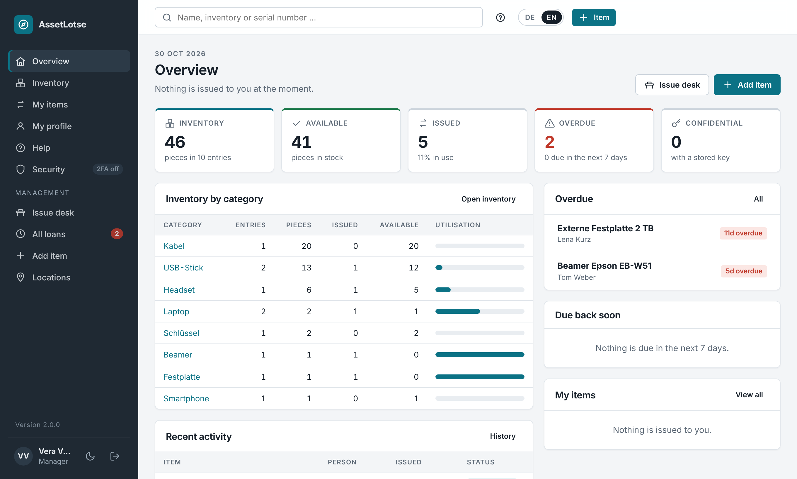
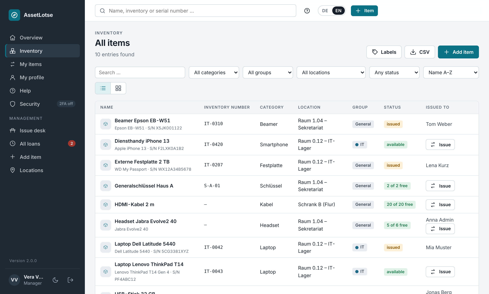
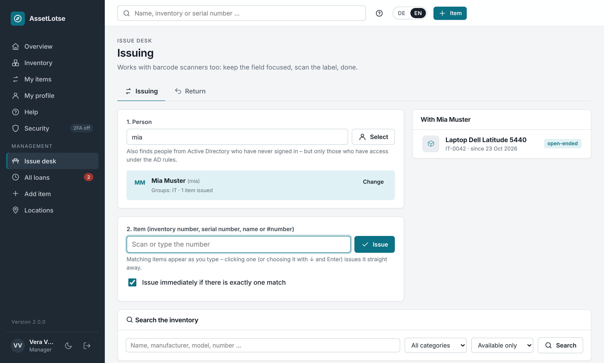

# AssetLotse

**Version 2.4.2** – see [CHANGELOG.md](CHANGELOG.md) for changes. · [Deutsche Version](README.md) · Developed by [helfi.space](https://helfi.space)

Web-based issuing and returning of equipment in institutes and offices: laptops, USB sticks, external drives, headsets, projectors, keys, work phones, cables … – everything that is handed out and comes back (no consumables). The goal: as simple as possible. Sign-in with local accounts or via Active Directory (Windows Server or Samba).

> **Built for my own use – use at your own responsibility.** I built AssetLotse primarily for myself, because I wanted exactly this kind of program for my own environment. I run it in production myself, so I usually notice bugs quickly and fix them promptly. If you would like to use AssetLotse too: you are welcome to – at your own responsibility. There is no warranty and no liability (sections 15 and 16 of the [license](LICENSE)). Try it in a test environment first and keep backups. Bug reports and suggestions for improvement are welcome – preferably as an [issue](https://github.com/soleil0815/assetlotse/issues); please report security vulnerabilities privately, as described in [SECURITY.md](SECURITY.md). I cannot promise support or response times.

- **Inventory** – items with name, **category** (a manager creates one simply by typing it; existing categories are suggested), manufacturer, model, **serial number**, **inventory number**, description/accessories, location, group, **quantity** and **photo**.
- **Confidential details** per item (e.g. BitLocker recovery key, PIN, password) – stored encrypted, visible only to administrators and managers of the item's group (optionally also to the current borrower after re-entering their password), every reveal is logged, never exported.
- **Issuing** – to a person, with a return date or **open-ended** (the default). Returns, extensions, overdue tracking, loan limits.
- **Issue desk** – pick the person, scan the label, done. USB/Bluetooth barcode scanners work without setup.
- **Fast data entry** – “Add similar” and “Save & next” for many identical devices; each inventory and serial number exists only once; while typing you see whether it is free and the next free number.
- **Locations** – fixed list of rooms and cupboards; picked from a list instead of typed.
- **Groups** – e.g. departments; items of a group are only issued to its members (plus “general” items).
- **Roles** – staff member, manager, administrator. The local admin account always works.
- **Barcode labels** (62 × 29 mm, PDF) – single or for a whole selection, e.g. for Brother QL printers.
- **Overview with key figures** – inventory, available, issued, overdue, utilisation per category.
- **CSV export** of the inventory (Excel-compatible) with an “Issued to” column.
- **Self-registration** (optional, off by default) – with admin approval, e-mail verification and domain restrictions.
- **Custom branding** – logo, login background image, colours and welcome texts.
- **Two-factor authentication** with an authenticator app (TOTP) or security keys (YubiKey/FIDO2, passkeys), recovery codes and a per-role policy.
- **E-mail notifications** via SMTP – issue and return confirmations, due-date reminders, overdue notices, daily digest for managers.
- **Active Directory / LDAP** – freely define which AD groups (or OUs) may sign in, manage or administer. AD groups can be mapped to AssetLotse groups.
- **Automatic backups** – daily, the last 10 backups are kept (configurable).
- German and English, responsive design with light and dark mode. Data stored in **SQLite** (default), optionally MySQL/MariaDB or PostgreSQL.

<p align="center">
  <br>
  <sub>Overview with key figures</sub>
</p>

<table>
  <tr>
    <td width="50%"><br><sub>Inventory – “Issue” right in the list</sub></td>
    <td width="50%"><br><sub>Issue desk – pick the person, scan the label, done</sub></td>
  </tr>
</table>

---

## Installation and updates

AssetLotse runs as a Docker container. The whole program is inside the ready-made image; the server only holds **`docker-compose.yml`**, **`.env`** (your settings) and the folder **`data`** (database, photos, keys, backups). Nothing is built or unpacked on the server. Requirement: Docker with Compose (the `docker compose` plugin or the older `docker-compose`).

### Installation

1. Create a folder, e.g. `/opt/assetlotse` (on a Synology e.g. `/volume1/docker/assetlotse`).
2. Put **`docker-compose.yml`** and **`env.example`** from the newest [release](https://github.com/soleil0815/assetlotse/releases/latest) there, save `env.example` as **`.env`** and adjust it as needed (port, time zone, …). Without entries the defaults apply.
3. Start – no GitHub login needed, the image is public:
   ```bash
   docker compose up -d
   ```

Then open `http://SERVER:9343` (e.g. `http://assetlotse.firma.local:9343`). On the first visit you create the local administrator account – only directly from the internal network (otherwise on the server with `create-admin`, see [Maintenance](#maintenance)).

The container sets the permissions of `./data` itself at start-up and then runs as user `PUID:PGID` (default `1000:1000`) – not as root (`PUID`/`PGID` `0` are refused). `./data` is readable only for this user, and so are new files in it. If another user on the server reads the backups (e.g. your own copy script), run it as root or as `PUID`.

**Your own settings belong in `.env`**, not in `docker-compose.yml` – that file stays unchanged and is replaced by a new one when needed. Extra folders or services (e.g. a backup drive or a MariaDB) go into your own `docker-compose.override.yml`; no update touches it.

**Another port:** put e.g. `ASSETLOTSE_PORT=8080` into `.env` and run `docker compose up -d` – done. The value applies outside on the server and inside the container. Allowed: 1024–65535. If the page does not show: with `ASSETLOTSE_BIND=127.0.0.1` in `.env` AssetLotse is only reachable on the server itself (meant for a reverse proxy on the same machine) – comment the line out for access from the network. Otherwise check the server's firewall (e.g. `sudo ufw allow 9343/tcp`).

### Updates

`docker-compose.yml` follows the tag **`latest`** – the newest version including the monthly security updates (patch day). So updates work the way you know from Docker:

- **With a container manager** such as Dockhand, Watchtower or Tugtainer – preferably with an update time **at night**, when nobody borrows anything.
- **By hand:**
  ```bash
  docker compose pull && docker compose up -d
  ```
- **With `./update.sh`** (in the release; optional): remembers the running image as `previous`, pulls the new version, starts it and waits for the health check. If the new version does not start, it offers to start the previous one again (with `-y` without asking). If the image brings a newer `docker-compose.yml`, it puts it in place and keeps the old one as `docker-compose.yml.alt`. Runs with `/bin/sh` (also on a NAS such as Synology); run it as root or as a member of the `docker` group.
  ```bash
  ./update.sh                 # newest version
  ./update.sh --rollback      # start the image from before the last update again
  ./update.sh --help          # everything it can do
  ```

**Every way is safe:** when a new version starts for the first time, AssetLotse backs up the database itself **before** changing anything (`…-vor-<version>.db`, under *Administration → Backups*; the three newest of these backups are never deleted automatically; SQLite only – with MySQL/PostgreSQL back up yourself first). Only then does it adapt the database.

**New `docker-compose.yml`:** the file carries a version number (`ASSETLOTSE_COMPOSE_VERSION`). If a new version needs a newer file, AssetLotse says so itself – in the log and as a notice for administrators. Then run `./update.sh` (puts the new file in place, the old one stays as `.alt`) or take `docker-compose.yml` from the release and run `docker compose up -d`.

### Pinning a version and going back

Put the version into `.env` and restart – container managers leave a fixed version alone:
```bash
ASSETLOTSE_TAG=2.0.0        # or one particular security update, e.g. 2.0.0-s3
docker compose pull && docker compose up -d
```
Or short: `./update.sh --version 2.0.0`. Back to the newest version: remove the line (or `ASSETLOTSE_TAG=latest`) or run `./update.sh`.

**Going back to an older version:** an older version does not start on a database that a newer version has already adapted – it stops with a clear message that names the backup to restore. So:
```bash
docker compose stop assetlotse
docker compose run --rm assetlotse backups                              # list the backups
docker compose run --rm assetlotse restore assetlotse-2026-11-02_031500-vor-2.1.0.db
# put the older version into .env, e.g. ASSETLOTSE_TAG=2.0.0
docker compose up -d
```
The backup `…-vor-2.1.0.db` is the state right before the update to 2.1.0. Whatever was entered since then is lost (the current state is backed up first as `…-vor-wiederherstellung.db`).

### Without internet

The release carries the images as files: `assetlotse-<version>-amd64.tar.gz` (usual servers and PCs) or `…-arm64.tar.gz` (e.g. Raspberry Pi, ARM NAS), each with a `.sha256`. Copy the file and `update.sh` to the server, then:
```bash
./update.sh --offline assetlotse-2.0.0-amd64.tar.gz
```
The script checks the checksum (if the `.sha256` is next to it), loads the image (`docker load`) and starts it; the version is fixed in `.env`. Without `update.sh`: `docker load -i assetlotse-2.0.0-amd64.tar.gz`, put `ASSETLOTSE_TAG=2.0.0` into `.env`, `docker compose up -d`.

### Switching from an installation before 2.0.0

Up to 1.12 the program files were on the server too (zip packages, local builds). The switch, once, in the existing folder:

1. `./update.sh --pull` – the existing script pulls the newest version and hands over to the new `update.sh`; the new `docker-compose.yml` is put in place and the container started. (If you built locally so far, this is exactly the switch to the ready-made image.)
2. `./update.sh --cleanup` – lists the program files that are no longer needed (e.g. `assetlotse/`, `Dockerfile`, `requirements.txt`, old zips, `packages/`, leftovers of aborted updates, old locally built images), asks, and deletes only these. **Never** touched: `data`, backups, `.env`, `docker-compose.yml`, `docker-compose.override.yml`, links, mounted drives (mount points) and every folder a container or `docker-compose.yml`/`docker-compose.override.yml` mounts – also not through links. Afterwards the folder only holds `docker-compose.yml` (and `.alt`), `.env`, `.env.example`, `update.sh` and `data`.

If a container manager updates AssetLotse, just replace `docker-compose.yml` there with the new one from the release.

## Building and publishing (GitHub)

The workflow `.github/workflows/docker.yml` builds the images on GitHub – for **amd64 and arm64**, each on a machine of that architecture and tested there – and puts them under **`ghcr.io/soleil0815/assetlotse`** (tags e.g. `2.0.0`, `2.0` and `latest`; security updates as `2.0.0-s1` and so on; plus `2.0.0-amd64` and `2.0.0-arm64` per architecture).

- **Every push to `main` and every pull request** is checked: build, tests in the image, Trivy – **nothing is published**.
- **Publishing is by hand only:** *Actions → Docker image → Run workflow → release* (on `main`). If the version number does not exist yet, it is built, tested, scanned and published only on success – `latest` only for the highest version. Plus the tag `v<version>` and a GitHub release with the text from the CHANGELOG and the installation files (`docker-compose.yml`, `env.example`, `update.sh`, image files for installing without internet). A published version is never rebuilt or overwritten.
- **New version:** raise the version number in `assetlotse/__init__.py` and `Dockerfile`, write a CHANGELOG entry, bring it to `main` by pull request, then *Run workflow → release*.

### Security and freshness of the image

Goal: the image stays secure and up to date by itself, **without version jumps**. Everything runs on GitHub in the workflow `.github/workflows/docker.yml`; whoever changes it changes what ends up on the servers.

**Reproducible build.** Every build from the same state gives the same image:
- **Base image** with a fixed version **and** checksum: `ARG PYTHON_IMAGE=python:3.13.<n>-slim-trixie@sha256:…` in the `Dockerfile`.
- **All Debian packages** of the image – including those of the base image – are listed with exact versions in `build/debian-packages.lock`. They are installed from one fixed state of the Debian archive (`snapshot.debian.org`, the timestamp is in the file); if any package differs, the build stops.
- **All Python packages** including all sub-dependencies are pinned exactly in `requirements.txt`, `pip` itself as `ARG PIP_VERSION` in the `Dockerfile`. They are installed with `--no-deps` and `--only-binary`, then `pip check` runs.
- **Nothing that is not needed at runtime stays in the image:** the package managers `pip`, `ensurepip` and `apt` are removed after the installation. So are the `openssl` tool and `openssl-provider-legacy` (old algorithms such as MD4) – Python only needs the library `libssl3t64`, which stays. (`dpkg` with its package list stays: it is part of the base system, and the vulnerability scan reads the installed packages from it.)
- **All Debian packages** are pinned per architecture: `build/debian-packages.lock` (amd64) and `build/debian-packages.arm64.lock` (arm64) – from the same state of the Debian archive; the Python packages are exactly the same on both architectures.
- **Setting new versions** – within the limits below – is done by `scripts/lock.py`: on GitHub *Actions → Docker image → Run workflow → relock* (resolves on one amd64 and one arm64 machine and commits the result to the branch the run was started on – `main` or the branch of a pull request). Locally: `scripts/lock.py refresh` (needs Docker, with emulation for arm64). `scripts/lock.py check` checks the files offline.

**Limits (the "base").** Automatic updates only happen **within** the base:
- the same Debian release (13 "trixie" is fixed in the base image's name – never a tag that changes silently),
- the same Python line (3.13; only newer 3.13.x),
- every Python package within its major version (before 1.0: within its minor version), never lower than before; the direct dependencies with these limits are in `requirements.in`,
- without a limit only calendar versions such as the root certificates (`certifi`) or time zone data.

Nobody raises the base silently (e.g. Python 3.14, Debian 14 or a new major version of a package) – that is always a deliberate new program version.

**Security update on patch day** (once a month on the second Tuesday – like Microsoft's Patch Tuesday –, 04:17 UTC; by hand at any time: *Run workflow → security-update*): `scripts/lock.py` fetches the newest versions within the limits. If there is nothing new, nothing happens. Otherwise the image is built **without cache**, the automatic tests run **in the finished image**, then Trivy scans it. Only if **everything** passed is the image published – as `<version>-s<counter>` (e.g. `1.10.0-s1`, `1.10.0-s2`: same program, only new packages), and as `latest` and `<minor>`. The new pinned versions are committed to `main` with an entry in the [CHANGELOG](CHANGELOG.md) (list of the changed packages) and tagged `v<version>-s<counter>`. A new program version starts again at `s1`. Servers following `latest` get the security updates by themselves; a server with a fixed version (`ASSETLOTSE_TAG`) keeps exactly that image. Security updates keep coming **automatically**, also without "release". If `main` holds unreleased program changes (merged, but not released yet), there is no security update until they are released as a new version.

**Vulnerability scan (Trivy).** Every image is scanned before it is published. Only vulnerabilities rated HIGH or CRITICAL that have a fix stop the release (plus secrets such as keys found in the image). Trivy is deliberately **not** a GitHub Action (trivy-action and setup-trivy were compromised in March 2026, CVE-2026-33634): `.github/install-trivy.sh` loads a fixed version and checks its SHA-256 checksum before it runs. Checked findings that cannot be exploited go into `.trivyignore` with a reason (`# reason: …` on the line above) and an expiry date (`exp:YYYY-MM-DD`); if either is missing, the scan stops; after the expiry date the finding is reported again.

**Daily scan.** Every day (05:43 UTC) the published `latest` (amd64 and arm64) is scanned again – for vulnerabilities that only become known after the release.

**ZAP scan in the code audit.** Once a month, one week before patch day (Tuesday 01:29 UTC; by hand at any time: *Actions → ZAP scan → Run workflow*), GitHub starts the program in a throwaway container with test data and lets [ZAP](https://www.zaproxy.org/) crawl and attack it without logging in (passive and active scan, never against real servers). The code audit the day after checks every finding against the code and fixes confirmed vulnerabilities before patch day. The scan does not run on normal pull requests.

**Base warning.** Every Monday the workflow asks [endoflife.date](https://endoflife.date) how long Debian and the Python line still get security updates: from 12 months before a note (yellow), from 6 months a red run.

**Security of the workflow.** All actions are pinned to commit checksums; every job has only the permissions it needs (write access only for the steps that publish); tests and Trivy never run in a job with write access; git credentials are not stored; publishing only from the branch `main`, never two runs at the same time; a published version is never overwritten, `latest` only points to the highest version.

**Only from the branch `main`:** the workflow only publishes runs from `main` (checked in `scripts/ci.py`). GitHub offers the additional lock via the environment `release` (*Settings → Environments → Deployment branches*) for private repositories only with GitHub Pro, Team or Enterprise; without it, a workflow changed on another branch and started by hand could still publish. So only give trusted people write access to the repository.

**Building it yourself** (e.g. for your own changes): `docker build -t assetlotse:own .` in the repository – with the same pinned versions; the machine needs HTTPS access to `snapshot.debian.org`. Then set `ASSETLOTSE_IMAGE=assetlotse` and `ASSETLOTSE_TAG=own` in `.env`.

**When a run is red.** Red before the *publish* step means: **nothing was published**, the servers keep the previous version. If a run stops while publishing (e.g. a network error), *Re-run failed jobs* or the next run completes what is missing – missing tags (`latest`, `<minor>`) and the release page are added, nothing is rebuilt. GitHub sends an e-mail; the cause is shown briefly on the run (*Actions* → run → annotations at the top and summary).

| What the run says | What to do |
|---|---|
| *Tests failed* | A new package does not fit the program. Adapt the affected code and release a new version – or wait until then (the run repeats on the next patch day). |
| *Trivy … finding(s)* for a release or security update | The fix lies outside the limits (e.g. only in a new major version): raise it deliberately and release a new version. If the finding provably cannot be exploited: entry with reason and expiry date in `.trivyignore`. |
| *Trivy … finding(s)* in the daily scan | A newly known vulnerability in the published image. Usually the next security update fixes it; right away: *Run workflow → security-update*. |
| *Base ends soon* (red) / *within a year* (yellow) | Debian or Python will soon stop getting security updates: plan the switch to the next base as a new version. |
| *unreleased program changes* | `main` holds changes that are not released yet: raise the version number and *Run workflow → release*. |
| *the scan itself failed*, network or download errors | Usually temporary: run it again (*Re-run jobs*). |
| *exists already with another image* | This version number is already published with another image – raise the version number. |
| *would ship OLDER packages* | The new version would have older packages than the last published security update (e.g. because an older copy was pushed): `git pull` so the newest pinned versions and the CHANGELOG are included, then push again. |
| *no packages locked for arm64* | The package list for arm64 is missing: start *Run workflow → relock* on the branch. |
| *resolved other Python packages than amd64* | A Python package is not (yet) available for arm64 in the same version: repeat the run later or adjust the limit in `requirements.in` deliberately. |
| *main changed while this run was going* | Something new arrived on `main` during the security update – nothing published; the next run repeats it. |

---

## Items and inventory

*Inventory* lists every item a user may see – with search (name, category, manufacturer, model, serial and inventory number, location, description) and filters for **category, group, location** and **status** (available / issued).

**Add item** (managers): only the **name** is required. In addition:

| Field | Notes |
|---|---|
| **Category** | free text, e.g. “Laptop”, “USB stick”, “Key”. Categories already in use are suggested – a new one is created simply by typing it. There is no separate category management. |
| Manufacturer, Model | free text |
| **Serial number**, **Inventory number** | e.g. from the label. Each number exists **only once** (case-insensitive) – a number already in use is rejected. While typing, the form shows whether the number is free, similar existing inventory numbers and the **next free** one (e.g. `IT-0044` after `IT-0043`, take it over with a click). Duplicates from older versions are kept (with a warning when saving) until corrected. |
| Description / accessories | e.g. “with charger and bag” |
| Location, Group | see [Locations](#locations) and [Roles and groups](#roles-and-groups) |
| **Quantity** | `1` = single item. More for identical things without their own number, e.g. 20 HDMI cables – they are then issued piece by piece. |
| **Photo** | upload (JPG, PNG, WEBP, GIF); resized and re-saved as JPEG. |
| **Confidential details** | see below |

**Adding many identical devices:**
- **“Save & next”** when adding an item immediately opens a new form with the same details as a template.
- **“Add similar”** on the detail page creates a new item with the same details – **without** inventory/serial number, photo and confidential details.

An item can only be deleted once it is no longer issued.

### Confidential details

For things like a laptop's **BitLocker recovery key**, a PIN or a password:

- **Stored encrypted** – the key is the `secret_key` in the data folder (see [Security](#security)).
- **Visible only to administrators and to managers who are members of the item's group** – and only after clicking **“Reveal”**. For items without a group (“General”) only administrators can see them; a manager without any group manages the whole inventory but sees no confidential details. Tip: assign devices with a BitLocker key to a group such as “IT” and add the IT managers to it. Staff members do not see the section (exception: the borrower option below).
- **The log is kept** even if the item or the account is deleted (name and person are stored with it); it is removed only by the retention period.
- **Every reveal, change and deletion is logged** (who, when); the log is shown on the detail page.
- **Never in the CSV export**, never in e-mails.
- **Optional for the borrower:** with the box *“The person this item is issued to may view the details themselves”* (per item, off by default), someone can look up e.g. the BitLocker key of their drive. Only the person who has the item **right now**, only **after re-entering their password** (checked against AD for AD accounts; failed attempts count towards the login lockout), and it ends with the return. Every view is logged as “viewed (borrower)”, as is switching the option on or off. Only people who may see the details themselves can set the box. So that nobody can “borrow” their way to a key, the option applies only to **single items** (quantity 1) and only if the **item was issued by someone who may see the details themselves** (administrator or manager of the group) – not via self-checkout and not when issued by other managers. Users with two-factor sign-in who signed in without the second factor in this session (internal network) must confirm it first.
- In the edit form the field stays empty – only fill it in to **replace** the details. To remove them, tick **“Delete confidential details”**.

> **Important:** confidential details can only be read with the matching `secret_key`. Always back up, move and restore the database **together with its `secret_key`**.

## Issuing and returning

- **Issuing** is done by a manager: on the detail page via **“Issue to …”** (pick the person, then either **Return by** a date or **open-ended**) or at the [issue desk](#issue-desk-and-barcode-scanner).
- **Default loan period** under *Administration → Settings*: **`0` = open-ended (the default)**. With a number > 0, every issue automatically gets that return date unless the manager chooses otherwise.
- **Open-ended loans** (e.g. a personal work laptop) are never overdue, get no reminders or overdue notices and never need to be extended.
- **Loans with a return date** can be extended (period and maximum number of extensions are configurable; managers can always extend).
- **By default staff members see no inventory**, only what is currently issued to them under **“My items”** (including the item page). Items are issued by managers or at the issue desk. This can be changed under *Settings → Inventory & issuing → Inventory visibility*: “own items only” (default), “items of their own groups and general items” or “whole inventory”. Managers and administrators always see the inventory.
- **Self-service checkout** is **off** by default. Administrators can enable self-service checkout, self-return and self-extension; self-checkout requires staff members to see the inventory.
- **All loans** (managers) shows active, overdue and completed loans of their groups.

## Issue desk and barcode scanner

*Issue desk* (managers) with two tabs:

- **Issuing:** 1. pick the person, 2. scan or type the item. `#number` (e.g. `#12`) always means the internal number; otherwise the lookup goes by **inventory number** (exact, ignoring case), **serial number** (exact) and **name** (partial match).
- **Return:** scan the item – the matching loan is shown and checked in.
- Option **“Issue/check in immediately on a unique match”** – then one scan per item is enough. This only happens for exact matches (inventory number, serial number, `#number`), never for a name search.
- **Search the inventory:** below the scan line you can search the inventory by text and category (by default only available items the manager may issue) and issue straight from the result list.
- **People from Active Directory:** with AD and a service account configured, the person search also finds staff who have never signed in to AssetLotse. **Only people who would be allowed to sign in under the AD rules are found** – same base DN, same user filter, same OUs/groups for staff, managers and administrators. Accounts disabled or expired in AD as well as computer and group objects are not shown. **“Take over”** checks the person again directly in AD and creates the account – with the groups from AD but initially as a **staff member**; the actual role (manager/administrator) is determined at the person's first own sign-in. An existing **local** account with the same name is never linked to AD. Requirements: a service account (bind DN) that may read `memberOf`/`tokenGroups`. The search checks at most 60 candidates or 5 seconds; if more match, “please search more precisely” appears. Every search is logged with manager and search text. OpenLDAP/classic Samba have no expiry date – there only the rules count.

**USB/Bluetooth barcode scanners** (keyboard emulation) work without setup: click into the field, scan the label – the scanner types the number and presses Enter. If no Enter arrives, configure the scanner for “Enter/CR suffix” according to its manual; wrong characters point to a different keyboard layout on the scanner. Labels should carry the **inventory number** (or serial number) as a barcode.

## Printing labels

For each item AssetLotse generates a **PDF label in the 62 × 29 mm format** – suitable e.g. for **Brother QL**
printers (QL-820NWB, QL-700 …) with DK-11209 labels or 62 mm continuous tape. The label shows the name,
category/model and serial number, a **barcode (Code 128)** containing the **inventory number**, the number in plain
text below it and the name of your organisation.

- **Single label:** item page → **Label** (opens the PDF; add `?anzahl=3` to the address for three identical ones).
- **Many at once:** filter the **Inventory** (e.g. category “Laptop”) → **Labels** – one PDF with one page per item
  (500 at most).
- Without an inventory number – or if it contains non-ASCII characters such as umlauts – the barcode contains
  `#<internal number>`. The issue desk finds both.
- **Printing:** choose the 62 × 29 mm label size in the print dialog and set **“Actual size” / 100 %** (not “fit to
  page”). For continuous tape set a length of 29 mm in the Brother driver.
- For laptops and other heavily used devices, **plastic labels** (e.g. Brother DK-22113 film or Zebra polyester)
  last much longer than paper.

## CSV export

Under *Inventory*, managers can download the inventory of their groups as **CSV** (semicolon, UTF-8 – opens directly in Excel). Columns: ID, name, category, manufacturer, model, serial number, inventory number, location, group, quantity, available, **issued to**. **Confidential details are never exported.** Cells starting with `=`, `+`, `-` or `@` are marked so Excel does not run them as formulas.

---

## Language and help

**German and English.** Everyone switches with **DE / EN** at the top right (also on the sign-in page). When signed in, the choice is saved in the profile – it then applies on every device and to the e-mails sent to that person. Without a choice, the browser language is used, otherwise the **default language** from *Settings → General* (default: German). Dates follow the language (20.10.2026 / 20 Oct 2026). Data such as item names, categories, group and location names stay as entered.

**Built-in help** (*Help* in the sidebar or **?** at the top right):
- Everyone sees only the topics for their role – staff members 7 (“For everyone”), managers 6 more (“Management”), administrators all 24 (11 more under “Administration”).
- The **?** jumps straight to the section for the current page (e.g. from the issue desk to the desk help).
- The texts follow your settings: loan period, extensions, self-service checkout, e-mail reminders, registration, mandatory 2FA, AD or local account …
- A search box covers all topics.

**What's new:** if there is something new after an update, a small dot appears next to the version number at the bottom left. It leads to *What's new*: short notes on new features, security updates and fixes – everyone only sees what concerns their role (staff, managers, administrators). After reading, the dot disappears until the next update. The entries live in `assetlotse/news.json` (German and English) and ship with every version.

**PDF manual:** `docs/Manual-AssetLotse.pdf` (English, with screenshots of the English interface) and `docs/Handbuch-AssetLotse.pdf` (German) – for staff, managers and administrators, including troubleshooting and emergency commands. The in-app help links the manual in the language of the interface at the top (*Manual (PDF)*).

**Maintaining translations:** The English text is also the key (`_("…")` in templates and Python, `T("…")` in `app.js`; the same English word with different German meanings: `_p("context", "…")`); the German texts live in `assetlotse/translations/de.json`. The test `tests/test_i18n.py` reports every text without a translation and German leftovers on English pages. Code, comments, log messages, the CHANGELOG and commit messages are in English. Help texts are stored per language in `assetlotse/templates/help/de|en/`.

## Locations

*Management → Locations* (managers and administrators). Define your rooms, cupboards or shelves once – several at a time, one per line. As soon as at least one exists, the location is **picked from a list when adding and editing items** instead of being typed. Upper/lower case and double spaces are normalised.

- **Renaming** updates all affected items. **Deleting** is only possible once no item is located there.
- **Locations typed freely earlier** appear under *In stock, but not defined*. Adopt them as a location or replace them with a defined one – the items are updated too. For a different spelling (“room 2.14”) or a typo (“rom 2.14”) the matching location is preselected.
- Group managers can add locations; renaming and replacing that affects items of other groups is reserved for administrators and managers of the entire inventory.
- The **inventory** can be filtered by location.
- Without defined locations the field stays a free text field.

## Roles and groups

| Role | Can |
|---|---|
| **Staff member** | “My items” (by default only these, no inventory); depending on the setting view the inventory and, with self-service checkout enabled, check out, extend and return items |
| **Manager** | Add/edit/delete items, issue, check in, use the issue desk, confidential details, export – for the items of **their groups** and general items. A manager manages the **entire** inventory only with *Manages the entire inventory* ticked in the user account – never as a side effect, e.g. because AD removed all their groups (on the update to 1.12.0, existing managers without a group got the box ticked automatically). |
| **Administrator** | Everything, plus users, groups, settings and Active Directory |

**Groups** are e.g. departments or teams. Every item either belongs to a group or is **general**. General items can be issued to everyone, group items only to members of that group. Under *Settings → Inventory & issuing → Inventory visibility* you decide whether staff members see only their own items (default), their groups' items and general items, or the whole inventory (issuing stays restricted either way).

---

## Setting up Active Directory

*Administration → Active Directory.* Preset buttons are available for Windows AD, Samba AD and OpenLDAP.

1. **Server**: `ldaps://dc1.institute.local` (separate multiple DCs with commas).
2. **Base DN**: `DC=institute,DC=local`
3. **Service account** (read access is sufficient), e.g. `CN=svc-assetlotse,OU=ServiceAccounts,DC=institute,DC=local` or `svc-assetlotse@institute.local`.
   Without a service account: leave the field empty and enter a **UPN suffix** (`institute.local`) – every user then binds directly.
4. **Roles via AD groups** – enter the names of the AD groups for each role, one per line:

   ```
   Administrators:  IT-Admins
   Managers:        AssetLotse-Managers
   Staff members:   Domain Users
   ```

   **“Load groups”** lists the groups from your AD; clicking a role adds them to it. Members of nested groups count as well. The highest matching role wins; anyone not in any of the groups is rejected. Roles of AD users are re-evaluated on every sign-in, so changes in AD take effect at the next login.

   Instead of a name you can also use the full DN of a group (if a name exists more than once) or an OU (`OU=Staff,DC=institute,DC=local` – then every user below it matches).
5. **“Test login”** shows the DN, all groups (with their origin: direct, primary or nested) and the role the user would get – without saving first.
6. **Map groups automatically**: for a group (*Administration → Groups*), enter the name of an AD group, e.g. `Dept-Physics`. Members are added or removed automatically at sign-in. Manually assigned groups without an AD link stay untouched.

**Group resolution** covers direct memberships, the **primary group** (e.g. *Domain Users*, which AD does not list in `memberOf`) and **nested groups** – via `LDAP_MATCHING_RULE_IN_CHAIN` and `tokenGroups`, so it keeps working if one of the two is unavailable. Groups are searched from the domain root, also outside the user OU.

**Encryption:** Windows DCs (LDAP signing) and Samba (`ldap server require strong auth = yes`, the default) often reject simple binds over unencrypted LDAP. Use **LDAPS** (port 636) or **StartTLS**.

**Fetch the certificate automatically:** under *TLS certificate*, click **“Fetch certificate from DC”**. AssetLotse reads the certificates of all configured DCs and adds the root CA automatically – via the AIA URL in the certificate (AD Certificate Services) or from AD itself (*Public Key Services*, requires the service account). Subject, issuer, validity and SHA-256 fingerprint are displayed; **“Trust & save”** stores them. The root CA is preferred so that the connection keeps working after the DC certificate is renewed. If no root CA can be found (e.g. Samba with a self-generated certificate), the server certificate itself is trusted – fetch it again after a renewal.

To be safe, compare the fingerprint on the DC, e.g. Windows: `certutil -store My`, Samba: `openssl x509 -in /var/lib/samba/private/tls/cert.pem -noout -fingerprint -sha256`.

Use the DC's **DNS name** as server (as it appears in the certificate). If you address the DC by IP, disable “Check hostname”.

Create a service account in Samba:

```bash
samba-tool user create svc-assetlotse --random-password   # then set a password:
samba-tool user setpassword svc-assetlotse
samba-tool user setexpiry svc-assetlotse --noexpiry
```

Local accounts always take precedence, so the local admin account works even when AD is unreachable.

### Background synchronisation (with service account)

Under *Background synchronisation* (default: on, **hourly**; 1, 2, 4, 8 hours or daily) AssetLotse regularly reads everyone who may sign in under the rules – with two large queries (all groups, all people) instead of one query per person, so even a few thousand accounts take seconds:

- **People without an AssetLotse account** are cached with username, name and email. The issue desk finds them **instantly** – as you type. Only if the cache finds nobody is AD searched live as well. “Take over” always checks the person directly in AD again.
- **Existing AD accounts** are updated – including people who have not signed in for a long time: **name** and **email** (e.g. after marriage), the **AssetLotse groups** (with “Assign groups automatically” – this decides who may receive which item) and **renames** in AD (different username – recognised by the fixed AD identifier *objectGUID*; loans and history stay with the account). The **role** is only updated for accounts that have signed in themselves before; accounts taken over at the desk stay staff members until then.
- **Disabled, expired, deleted or no longer authorised in AD:** the person is removed from the cache, their AssetLotse account is **deactivated** and signed out (loans remain visible). If the person is authorised again later, the account is **reactivated automatically** – at the next run or immediately at their next sign-in; but only if the synchronisation deactivated it. Accounts locked by hand stay locked. If someone already signed in with a new name after a rename in AD, AssetLotse recognises the account by its objectGUID – no second account is created. If a username is reassigned in AD to a **different** person, they do not get the old account and its history (sign-in refused, note in the log – rename the old account).
- **Protecting administrators:** AD administrators are **never deactivated automatically** (always only after confirmation). Roles are not downgraded if no active administrator would remain or many accounts would lose rights at once (e.g. a mistyped admin rule) – a warning is shown instead. Anyone signed in with an AD account cannot save AD settings under which they would no longer be an administrator, and cannot switch AD off.
- **Old accounts without an AD identifier** (created before 1.6 and already gone from AD at the first run) are never reactivated automatically – an administrator decides whether the same person returned or the name was reassigned (activate or rename the account by hand). AD accounts can be renamed under *Users* for this, e.g. to `anna-old`.
- **Confirm first:** until the first confirmation (e.g. right after the update) and whenever **more than 20 %** (2 accounts or more) or **all** AD accounts would be affected at once, or **no active administrator** would remain, nobody is deactivated automatically. The AD page then lists the affected usernames with the button **“Deactivate these accounts”** – your own account and the last administrator always stay active. If the list from AD is incomplete (server size limit), nothing is deleted or deactivated; if reading the groups is aborted, the run does not happen at all (roles would be wrong otherwise). If a run fails, the old state is kept; next attempt after 15 minutes.
- Status (last run, numbers, errors) and **“Synchronise now”** are on the AD page. Switching off deletes the cache.

**Privacy:** username, name and email of all authorised people are cached, even if they never use AssetLotse – please include this in your data protection documentation (or switch the synchronisation off).

---

## Self-registration

**Off** by default. Under *Administration → Settings → Accounts → Self-registration*:

| Setting | Effect |
|---|---|
| **off** | No registration link; `/registrieren` does not exist. |
| **admin approval** | The account is created but locked until an admin approves it (*Users → Awaiting approval → Approve/Reject*). |
| **immediately active** | The account can be used right away. |

Options: **verify e-mail address** (link valid for 48 h – only with e-mail sending configured and the *address of AssetLotse* filled in; links are never built from a visitor's request. If an admin switches registration on while the address is empty, AssetLotse takes the address the admin is using right now), **notify admins**, **allowed e-mail domains** (e.g. `institute.org`), **group for new accounts**. If a privacy policy is set under *Legal*, it must be accepted when registering.

New accounts are always **staff members**. Protection for internet-facing installations: invisible honeypot field, minimum fill-in time, max. 5 registrations and 30 attempts per hour and IP (slows down probing for existing names and addresses), reserved names (admin, root …), usernames that exist in Active Directory are blocked, passwords of at least 10 characters. Unverified accounts are deleted automatically after 7 days.

## Branding (corporate design)

*Administration → Branding.* All changes appear immediately in a live preview; “View login page” shows the result as visitors see it.

- **Logo** (PNG with transparent background or SVG) – in the sidebar, on the login page, in e-mails and as browser icon (the favicon is generated automatically). Options: show the name next to it or not, place the logo on a light plate (for dark logos).
- **Login background image** – resized automatically; metadata such as GPS location is removed. Darkening via slider, shelf graphic on/off.
- **Colours** – primary colour (buttons, links), accent colour, sidebar. Text colours are chosen automatically for readability, including dark mode. E-mails use the colours and logo too.
- **Texts** – name (default “AssetLotse”, e.g. replace it with your institute's name), small heading and welcome text on the login page.

“Reset all” restores the defaults. Files are stored in `./data/branding` and survive updates. SVG logos containing scripts or external references are rejected for security reasons. Logo and background are publicly reachable (they are needed on the login page) – don't use anything confidential.

## Two-factor authentication

Every user sets it up under **Profile → Security** (also reachable from the user menu):

- **Authenticator app (TOTP):** scan the QR code, confirm with a code. Works with Microsoft/Google Authenticator, Aegis, 2FAS, Bitwarden, Yubico Authenticator … – and everywhere, including `http://IP:9343` on the LAN.
- **Security key (WebAuthn/FIDO2):** insert the YubiKey, touch it – done. Device fingerprint/Face ID (passkey) works too. Requires **HTTPS** and is bound to the address under which the key was registered (e.g. `assets.institute.org`). Several keys per account are possible – registering a spare key is a good idea.
- **Recovery codes:** 10 one-time codes are shown once during setup. They let you in without phone or key.

Under **Administration → Settings** you decide for whom 2FA is **mandatory for access from outside** (nobody – the default, administrators, managers + admins, everyone). Affected users are guided through the setup at their next sign-in and can only continue afterwards. If you store confidential details (BitLocker keys), require 2FA at least for managers + admins.

**Treat the internal network differently** (*On the internal network*):

| Setting | Effect on the LAN |
|---|---|
| same as outside (default) | same rules as from the internet |
| not mandatory | nobody has to set up 2FA; users who have it are still asked |
| no 2FA prompt | the password is enough on the LAN |

- **What counts as internal** is set under *Internal network* (one network per line, e.g. `192.168.10.0/24`). Empty means `10.0.0.0/8`, `192.168.0.0/16`, `fc00::/7` – **without** loopback (tunnels and forwarders without a visitor address come in that way; add `127.0.0.0/8` if needed) and **without** `172.16.0.0/12`, because Docker creates its networks there (otherwise e.g. every request arriving via the Docker gateway would look internal). If your LAN uses 172.16–31.x, enter it explicitly. Ideally narrow it down to your actual LAN anyway.
- Behind the reverse proxy the **real visitor address** counts. The proxy must send `X-Forwarded-For` (Nginx Proxy Manager, Caddy and Traefik do so by default). If it is missing, the request is treated as **external** for safety. Forged headers from the internet are ignored.
- **Important – port 9343 for the proxy only:** by default all private networks are trusted proxies (`ASSETLOTSE_TRUSTED_PROXIES=private`). Any LAN host that reaches AssetLotse **directly** on port 9343 can therefore send a forged `X-Forwarded-For` header (e.g. to count as “internal” or to evade the per-address login lockout). Publish the port only to the proxy – in `.env` e.g. `ASSETLOTSE_BIND=127.0.0.1`, or no published port and a shared Docker network with the proxy – **or** set `ASSETLOTSE_TRUSTED_PROXIES` to the proxy's address (e.g. `172.18.0.5` or the proxy's Docker network). This also matters for internet access: if someone reaches port 9343 e.g. via **IPv6** and Docker relays it internally, the request appears to come from the Docker gateway (172.x.0.1) – which the default setting trusts.
- The settings page shows how your current connection is classified. To check, open it once from a phone on mobile data – it must say “external”.
- A session started on the LAN **without** a second factor is only valid internally: using it from outside (laptop at home) requires a new sign-in. “Stay signed in” has no effect in this case.
- Internal devices with their own public IPv6 address count as external unless their prefix is listed.
- **Internal computers using the public domain:** when they call the internet address, the router (e.g. a FritzBox) often presents them with your own public IP – so they would look external. Enter your fixed IP or your **DynDNS name** under *Own internet connection*; the name is resolved again every 5 minutes, so a changing IP is followed. **Caution:** the guest Wi-Fi and every other device behind the router also arrive with this address and then count as internal. The cleaner alternative is an internal DNS entry (split DNS) that points the domain to the server's internal address on the LAN.

**Sign-in problems – without the command line:** under *Users* → open the account → *Sign-in and security*:
- **Reset two-factor authentication** – removes app and security keys; sign-in works with the password again (if 2FA is mandatory, setting it up again is required).
- **Lift sign-in lock** – after 8 failed attempts sign-in is locked for 5 minutes; locked accounts are marked in the user list (filter “Sign-in lock”).

If all admins are locked out: with “no 2FA prompt” on the internal network, an admin can sign in from the LAN without a second factor. Otherwise, in an emergency on the server:

```bash
docker compose exec assetlotse docker-entrypoint.sh flask --app wsgi reset-2fa admin
```

Technical details: TOTP according to RFC 6238 (secrets stored encrypted, codes cannot be reused), WebAuthn via Yubico's `fido2` library including signature-counter checks, lockout after repeated failures, the second step expires after 5 minutes. In addition there is a per-username limit across all addresses (40 failures in 15 minutes from outside, 100 on the internal network); after 10 wrong second-factor codes the password must be entered again. Anyone who signed in on the LAN without a second factor must confirm it under *Profile → Security* before changing factors or recovery codes (first-time setup excepted).

## E-mail notifications

*Administration → E-mail.* Enter SMTP server, encryption (STARTTLS / SSL/TLS / none), credentials and sender, then click **“Send test mail”**.

| Notification | When |
|---|---|
| Issue confirmation | immediately, with name and return date (or “open-ended”) |
| Return confirmation | immediately (off by default) |
| Reminder | X days before the return date, once per loan – only for loans with a return date |
| Overdue notice | from the first overdue day, repeated every N days, at most M times |
| Manager digest | daily, only if their groups have overdue loans (off by default) |
| Manual | envelope icon next to a loan under *All loans* |

- Reminders and overdue notices run **once a day** from the configured hour. Several items of one person go into **one** e-mail. The mail log prevents duplicates – even with several server processes.
- **Open-ended loans** never get reminders or overdue notices. With the default loan period of `0`, AssetLotse therefore only sends confirmations.
- **“Send now”** runs immediately. Alternatively via cron: `docker compose exec -T assetlotse docker-entrypoint.sh flask --app wsgi send-reminders`
- The **address of AssetLotse** (e.g. `https://assets.institute.org`) is needed for links in e-mails.
- E-mail addresses come from the AD attribute `mail` for AD users and from user management for local users. Everyone can switch notifications off in their profile.
- Typical settings: Exchange/Microsoft 365 `smtp.office365.com:587 STARTTLS` · internal Postfix `mail.institute.local:25 none` · Gmail `smtp.gmail.com:587 STARTTLS` with an app password.

## Reverse proxy and HTTPS

Example with Caddy (obtains certificates automatically, or uses `tls internal` on the LAN):

```
assets.institute.local {
    tls internal
    reverse_proxy 127.0.0.1:9343
}
```

Nothing else is required: AssetLotse detects the reverse proxy automatically. Forwarding headers (real visitor IP, HTTPS) are only accepted from private networks – i.e. from the proxy, never directly from the internet. Cookies automatically get the Secure flag over HTTPS; sign-in via `http://IP:9343` on the LAN keeps working. Security keys (WebAuthn) require HTTPS.

**AssetLotse enforces HTTPS itself** (since 2.4.0, same rules as Catalytix and Helfi.Space since 2.4.2): as soon as an address has been opened once over HTTPS through the proxy, AssetLotse permanently redirects HTTP for that address to `https://<same name>/…` (301, forms 308 – they keep their data). It remembers the address in the data folder (`https-hosts.txt`); a proxy without any HTTPS is therefore never redirected into nothing. AssetLotse sends HSTS (one year, this host name only) only where it had to redirect itself – a proxy that redirects on its own (NPM with “Force SSL”) keeps its own HSTS header, no second one is added. AssetLotse recognises the way in from `X-Forwarded-Proto`, or else `X-Forwarded-Port` (80 = HTTP, 443 = HTTPS). On a Synology, create both rules: `http://asset…` and `https://asset…`, each to `http://IP:9343`. Direct access via `http://IP:9343` on the LAN and requests to an IP address are never redirected. `ASSETLOTSE_FORCE_HTTPS=1` applies right away (and always sends HSTS), `0` turns it off.

When publishing to the internet, do not forward port 9343 on your router – only the proxy should be reachable from outside. The login page deliberately reveals nothing about the setup (no version number, no AD hint, identical error messages for unknown users, wrong passwords and locked accounts).

## Privacy and running on the internet

AssetLotse is built so that users' browsers **only talk to your own server**:

- **Fonts** (Inter) are bundled – no connection to Google Fonts.
- **No external services:** nothing is fetched from third-party servers and no scripts are loaded from elsewhere. The server itself only connects to your own services (AD/LDAP, mail server) and – when fetching the DC certificate – possibly to the AIA address of your certificate authority.
- **Item photos** are only reachable after signing in.
- **Cookies:** only strictly necessary ones (sign-in, form protection) – no cookie banner required. No tracking, no ads.

Enter the addresses of your **imprint and privacy policy** under *Administration → Settings → Privacy → Legal*, e.g. pages on the institute's website. The links appear on the login page, in the sidebar and in every e-mail; self-registration requires accepting the privacy policy.

The privacy policy (or your record of processing activities) should list what AssetLotse stores: name, username, e-mail address, group memberships, loans with dates (who received what, who issued/checked it in), a log of sent e-mails, the access log of confidential details (which manager revealed/changed them and when) and, with two-factor authentication, the registered keys. If the server is operated by someone other than the institution itself, you need a data processing agreement (Art. 28 GDPR). Involve your staff council when introducing it, since loans are linked to individual people.

**Retention periods** (*Settings → Privacy → Retention*, default **12 months**): completed loans are deleted automatically the configured time after their return, and so are e-mail log entries. Only the number of loans per item is kept, so statistics stay correct. Active (including open-ended) and overdue loans and their reminder entries are never deleted. The job runs once a day; “Clean up now” or `flask --app wsgi apply-retention` runs it immediately. When a user is deleted, their loans are removed at once (the per-item count is kept). Unconfirmed self-registrations are deleted after 7 days. The **access log of confidential details** is also deleted after this period (with “never delete” it is kept until the item is deleted). State the retention periods in your privacy policy as well.

## Security

Please report security problems **privately**, not as an issue – see [SECURITY.md](SECURITY.md).

- **Passwords** for local accounts: at least 10 characters. Repeated failures briefly lock the login; from outside also per user name, in case someone tries many addresses.
- **Sign out everywhere:** *Profile → Security → Signed-in devices*. This also happens automatically when the password is changed or an admin resets two-factor authentication – the current device stays signed in.
- **AD accounts** with an open session are re-checked every 4 hours (using the service account): anyone disabled, deleted or removed from the permitted group in AD is signed out; role and groups are updated. If AD is unreachable the session stays. Without a service account (direct bind) this check is not possible.
- **Stored encrypted in the database:** the credentials for the AD service account and the mail server, the **2FA secrets** and the items' **confidential details** (key: `data/secret_key` or `ASSETLOTSE_SECRET_KEY`). A copy of the database without that file cannot read them.
- **The `secret_key` belongs to the database:** if it is changed or lost, all 2FA sign-ins fail, the stored SMTP/AD passwords can no longer be read **and all confidential details (e.g. BitLocker keys) are lost for good**. So back up, restore or move a database only **together with its `secret_key`** – and keep the `secret_key` itself safe (it is the master key to the confidential details). On first start AssetLotse stores a check value of the key (not the key itself) and **refuses to start** if the key does not match the database – check the log and bring back the matching `secret_key`. To accept a new key deliberately, start once with `ASSETLOTSE_ACCEPT_NEW_KEY=1` (remove it afterwards), then reset users' 2FA, re-enter the SMTP/AD passwords and enter the confidential details again.
- **Browser protection:** strict Content Security Policy (scripts and stylesheets only from your own server, neither inline scripts nor inline styles), protection against framing by other sites, CSRF protection on all forms. Pages for signed-in users (including CSV export and photos) are marked private and are not stored in proxy/CDN caches or on the browser's disk.
- **Showing and changing confidential details** (including the share with the borrower) always requires the second factor in the current session for accounts with 2FA – even where the password is enough to sign in on the internal network.
- **First second factor:** setting up two-factor sign-in signs out all other devices. Changing the password is throttled against guessing.
- **Uploaded photos** are resized and re-saved as JPEG – metadata and hidden content in image files are not kept. The **CSV export** marks cells starting with `=`, `+`, `-` or `@` so Excel does not run them as formulas.

### Automatic sign-out

*Settings → Security → Automatic sign-out* – anyone who does nothing in AssetLotse for this long is signed out (e.g. a browser left open at the issue desk). Every page opened and every saved form counts as activity.

| Setting | Effect |
|---|---|
| *For everyone (hours)* | default **12**; start value from `ASSETLOTSE_SESSION_HOURS`, `0` = off. Allowed 0.25 (15 minutes) to 720 |
| *For administrators* | optionally shorter, e.g. `1` – empty = same as for everyone |
| *From outside* | optionally shorter for access from the internet – empty = same as internally |
| Notice 2 minutes before | “You will be signed out in 2 minutes – continue working?” (on by default). Clicking *Continue working* extends the session, even if you are only typing |
| Sign out when the browser is closed | “Stay signed in” is no longer offered; existing “Stay signed in” sessions end at the next browser restart |

- The **shortest limit that applies** wins (an administrator from outside: the shorter of the two).
- The limit **also applies with “Stay signed in”** – that only keeps the session across a browser restart (at most 14 days), not beyond the limit.
- When the time is up, the **open page** also switches to the sign-in page, so that e.g. a BitLocker key on screen does not stay visible. Working in another tab counts too.

## Backups

*Administration → Backups.* The database is **backed up automatically every day** (default from 2 a.m.) – while running, without downtime. Every backup is checked for corruption after writing. The **newest 10 backups** are kept (configurable 1–100); older ones are deleted automatically. In addition, every new version backs up on its first start (`…-vor-<version>.db`); the three newest of these are always kept – you need them to go back to an older version.

- **Location:** `./data/backups` on the server. `ASSETLOTSE_BACKUP_DIR` sets a different folder, e.g. a mounted NAS share (add it as an extra volume in `docker-compose.override.yml`, e.g. `/mnt/nas/assetlotse:/backup`).
- **“Back up now”** creates a backup immediately (useful before bigger changes). Single backups can be downloaded or deleted.
- **If a backup fails**, a warning sign appears on the *Backups* menu entry and administrators get an e-mail (if e-mail sending is set up).
- The **database** is backed up (items, confidential details in encrypted form, users, loans, settings). **Photos** (`./data/images`), logo and **`secret_key`** are files in `./data` – take the whole folder with you when moving servers.
- **Always restore a database together with its `secret_key`**, otherwise 2FA and stored SMTP/AD passwords stop working and the confidential details cannot be read (see [Security](#security)). If you copy backups to another place, keep a copy of the `secret_key` there too – separately and well protected.
- Important: backups on the same server protect against mistakes and broken updates, **not** against a disk failure. Copy the folder to another place regularly.
- SQLite only. With MySQL/MariaDB or PostgreSQL use `mysqldump` or `pg_dump`.

**Restoring** (the current state is backed up automatically first):

```bash
docker compose stop assetlotse
docker compose run --rm assetlotse backups
docker compose run --rm assetlotse restore assetlotse-2026-10-19_020012.db
docker compose start assetlotse
```

`backups` and `restore` also work when AssetLotse does not start (e.g. because the database comes from a newer version – see [Pinning a version and going back](#pinning-a-version-and-going-back)).

Privacy: backups contain all data, including data already deleted by the retention period – with 10 daily backups up to 10 days longer. Mention this in your privacy policy.

---

## Configuration (file `.env`)

| Variable | Meaning |
|---|---|
| `ASSETLOTSE_TAG` | Version of the image: `latest` (default – newest version with security updates) or fixed, e.g. `2.0.0` or `2.0.0-s3` (see [Pinning a version](#pinning-a-version-and-going-back)) |
| `ASSETLOTSE_IMAGE` | Address of the image (default `ghcr.io/soleil0815/assetlotse`; e.g. for a fork) |
| `DATABASE_URL` | e.g. `mysql+pymysql://assetlotse:secret@db/assetlotse?charset=utf8mb4` (the MySQL driver is included; PostgreSQL needs your own image build with `psycopg[binary]` in `requirements.txt`) |
| `ASSETLOTSE_SECRET_KEY` | Session and encryption key; if unset, generated once and stored in `data/secret_key`. Encrypts 2FA secrets, stored SMTP/AD passwords **and the confidential details** – **do not change it later** (see [Security](#security)) |
| `ASSETLOTSE_ACCEPT_NEW_KEY` | `1` = deliberately accept a changed key (otherwise AssetLotse refuses to start when the key does not match the database). Set only once |
| `ASSETLOTSE_BIND` | Address the port is published on (default `0.0.0.0` = all). `127.0.0.1` if the reverse proxy runs directly on this machine (not as a container, or with `network_mode: host`) – then nobody can bypass the proxy. If the proxy runs as its own container, put both into a shared Docker network instead |
| `ASSETLOTSE_PORT` | Port (default `9343`, allowed 1024–65535) – applies on the Docker host and in the container, change it only here |
| `TZ` | Time zone (default `Europe/Berlin`). If the zone is missing from the image, the log shows “Zeitzone TZ=… nicht gefunden – Uhrzeiten in UTC” (times in UTC) at start-up; check with `docker compose exec assetlotse date` |
| `PUID` / `PGID` | User/group owning `./data` (default `1000`) |
| `ASSETLOTSE_TRUSTED_PROXIES` | Who may send proxy headers: `private` (default), `none` or a list such as `172.18.0.0/16,192.168.0.11` |
| `ASSETLOTSE_SECURE_COOKIES` | `auto` (default: over HTTPS), `1` (always), `0` (never) |
| `ASSETLOTSE_FORCE_HTTPS` | `auto` (default: switch once HTTPS through the proxy was seen), `1` (always), `0` (never) – redirect HTTP through the reverse proxy to HTTPS and send HSTS |
| `ASSETLOTSE_LOGLEVEL` | `INFO` (default), `DEBUG` for LDAP troubleshooting |
| `ASSETLOTSE_SESSION_HOURS` | Start value of the [automatic sign-out](#automatic-sign-out) in hours without activity (default `12`, `0` = off). After that, what is saved under *Settings* applies |
| `ASSETLOTSE_BACKUP_DIR` | Folder for automatic backups inside the container (default: `backups` in the data directory). Must be mounted as a volume in `docker-compose.override.yml` – otherwise the container warns at start-up |
| `ASSETLOTSE_SCHEDULER` | `0` = no scheduled jobs (reminders, backup, retention) in this process, e.g. when several app servers run and only one should do them. Default `1` |
| `ASSETLOTSE_SOURCE_URL` | Link to the source code on the *About this program* page (default: this repository; for a modified version, its source code) – see [License](#license) |

Everything else (default loan period, extensions, self-service checkout, inventory visibility, AD, e-mail, branding, registration, 2FA policy) is configured in the web interface.

**Choosing a database:** SQLite easily handles an institute's equipment with thousands of items and many concurrent users – and a backup is just a file copy. MariaDB/MySQL or PostgreSQL are worthwhile if you already run a database server with a backup routine, or want several app servers in parallel.

---

## Maintenance

Commands in the running container – always through the entrypoint, so they run as `PUID:PGID` like the app (otherwise e.g. backups end up owned by root and the app cannot offer them):

```bash
E="docker compose exec assetlotse docker-entrypoint.sh flask --app wsgi"
$E reset-password admin       # reset password (re-enables the account, lifts the sign-in lockout)
$E reset-2fa admin            # reset second factor (phone/key lost)
$E make-admin michael         # give an account the admin role back (and re-enable it)
$E unlock admin               # lift the lockout after failed attempts right away
$E list-admins                # list all admin accounts
$E apply-retention            # apply retention period now (delete old loans)
$E send-reminders             # send reminders now
$E create-admin emergency     # additional local admin account
$E backup                     # back up the database now
```

Listing and restoring backups (stop the container first): see [Backups](#backups).

In the console of Dockhand (or another container manager) leave out `docker compose exec assetlotse` – enter `docker-entrypoint.sh flask --app wsgi …` directly there.

### Locked out as administrator – what now?

You can only lock yourself out in the web interface; through the server you always get back in (`$E` as above):

| What happened? | Solution |
|---|---|
| Password forgotten | `$E reset-password admin` – asks twice for the new password (at least 10 characters), re-enables the account and lifts the sign-in lockout |
| Phone or security key lost | first use a recovery code, otherwise `$E reset-2fa admin` |
| "Too many failed attempts" | 8 failed attempts lock name and address for 5 minutes – wait or `$E unlock admin` |
| Admin role removed by mistake or account disabled | `$E make-admin NAME`. For an AD account the AD rules set the role again at the next sign-in – then sign in with a local account and fix the rules |
| No admin account left / not sure which exist | `$E list-admins`, then if needed `$E create-admin emergency` |
| Active Directory misconfigured or unreachable | sign in with the **local** admin account – that always works without AD; there you can also switch AD off |
| Database damaged or wrong change | restore a backup, see [Backups](#backups) |

**Precautions:** create a second local emergency admin account with a long password in your password manager, keep the 2FA recovery codes and back up the `./data` folder – database and `secret_key` belong together.

The initial setup in the browser (`/setup`) works only once and only from the internal network (or via `localhost`) – otherwise any stranger could become admin of a freshly installed, openly reachable instance. If there is no administrator account later on (e.g. deleted by mistake), create one with `create-admin` on the server – for security reasons this is no longer possible via the web.

The database schema is upgraded automatically on start-up (missing columns are added) – after the backup `…-vor-<version>.db`. So updates keep your data.

## Tests

In the repository (development):

```bash
python -m pytest -q tests
python -m mypy            # type check (settings in mypy.ini; tools: tests/requirements-typing.txt)
```

The type check is introduced step by step: the modules in the strict sections of `mypy.ini` must have no findings (otherwise `tests/test_typing.py` fails), findings in all others are only listed. Once a module is clean, it goes on the strict list.

On GitHub the tests run on every push and pull request in the finished image, on amd64 and arm64.

## Project layout

```
assetlotse/
  __init__.py      App factory, configuration, CLI commands
  models.py        Data model (users, groups, items, confidential details and access log,
                   loans, locations, settings, mail log, security keys)
  ldap_auth.py     Active Directory / LDAP sign-in, group resolution and role rules
  ldap_tls.py      Fetching and verifying DC certificates
  twofa.py         Two-factor authentication (TOTP, WebAuthn, recovery codes)
  mailer.py        SMTP sending, notifications, daily scheduler
  retention.py     Retention periods (delete old loans, mail and access log)
  backup.py        Automatic database backups (SQLite), keeping the last N
  branding.py      Logo, background image, colours
  proxy.py         Automatic reverse-proxy and HTTPS detection
  netzone.py       Internal network or access from outside (for the 2FA rules)
  lockout.py       Sign-in lock after failed attempts
  labels.py        Label PDF (62 × 29 mm) with Code 128 barcode, no extra library
  i18n.py          German/English, language selection, date formats
  translations/    German texts (de.json)
  views/           Pages: main (incl. About/License, language switch), assets (inventory, photos, export, labels),
                   loans (issuing, returns, issue desk), locations, admin, security, register, help
  templates/       Jinja templates (incl. e-mail templates and help texts help/de, help/en)
  static/          CSS, JavaScript (no build step)
docs/              Handbuch-AssetLotse.pdf, Manual-AssetLotse.pdf (linked in the help)
tests/             Automated tests
build/             Pinned Debian package lists per architecture and install scripts for the image
scripts/           Build chain: lock.py (pin versions), ci.py (decisions of the workflow), eol_check.py
docker-compose.yml The only program file on the server (besides .env and data) – do not edit
update.sh          Updating by hand (optional), going back, without internet, cleaning up old installations
```

## License

AssetLotse is free software under the **GNU Affero General Public License, version 3 or later** (AGPL-3.0-or-later) – full text in [LICENSE](LICENSE).

In short: anyone may use, share and modify AssetLotse, commercially too. Anyone who distributes a **modified version** **or runs it on a network for others** must make the source code of that version available under the same license. AssetLotse comes with no warranty.

After signing in, version, license, developer ([helfi.space](https://helfi.space)) and source link are shown on the *About this program* page – click the version number at the bottom of the sidebar. By default the link points to this repository; anyone running a **modified** version sets the address of their own source code with `ASSETLOTSE_SOURCE_URL` in `.env`. “AssetLotse” is also the default name in the interface; you can replace it, e.g. with your institute's name, under *Administration → Settings* (Name) or *Branding*.

Libraries used (under their own licenses, installed at setup time): Flask, Flask-SQLAlchemy, Flask-Login, Flask-WTF, SQLAlchemy, PyMySQL, ldap3, cryptography, fido2, segno, Pillow, requests, gunicorn/waitress.

Bundled fonts: **Inter** (The Inter Project Authors) under the SIL Open Font License 1.1 – license texts in `assetlotse/static/fonts/`.
