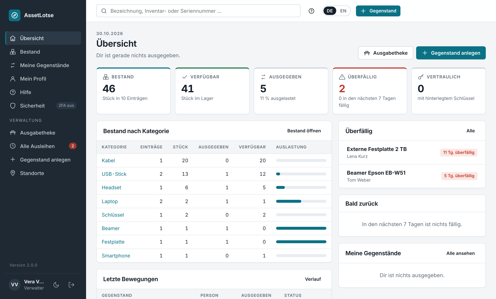
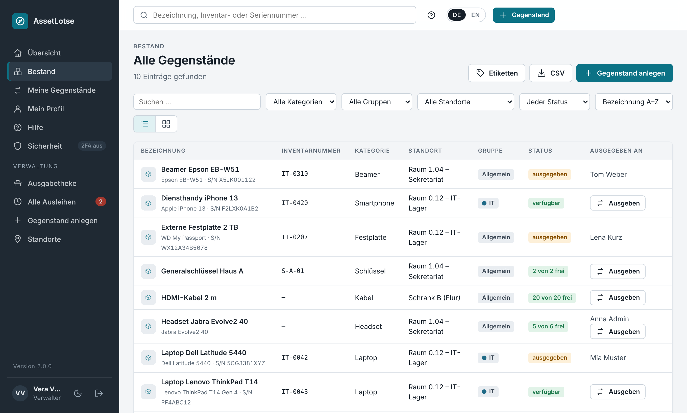
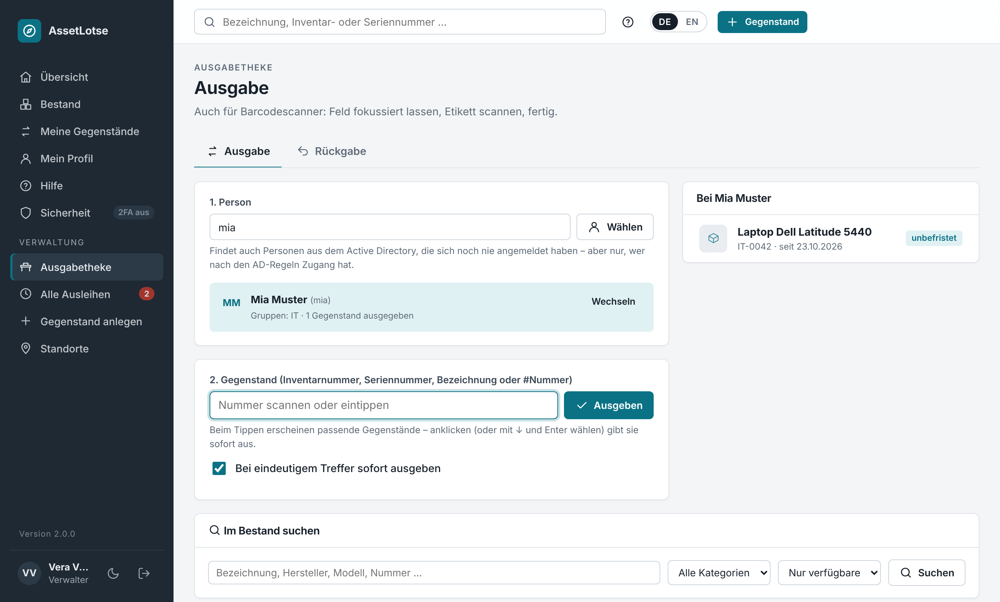

# AssetLotse

**Version 2.1.0** – Änderungen siehe [CHANGELOG.md](CHANGELOG.md) (englisch). · [English version](README.en.md) · Entwickelt von [helfi.space](https://helfi.space)

Webbasierte Ausgabe und Rücknahme von Arbeitsmitteln in Institut und Büro: Laptops, USB-Sticks, externe Festplatten, Headsets, Beamer, Schlüssel, Diensthandys, Kabel … – alles, was ausgegeben und wieder zurückgegeben wird (kein Verbrauchsmaterial). Ziel: so einfach wie möglich. Anmeldung lokal oder über Active Directory (Windows Server oder Samba).

- **Bestand** – Gegenstände mit Bezeichnung, **Kategorie** (legt der Verwalter einfach durch Eintippen an; vorhandene Kategorien werden vorgeschlagen), Hersteller, Modell, **Seriennummer**, **Inventarnummer**, Beschreibung/Zubehör, Standort, Gruppe, **Anzahl** und **Foto**.
- **Vertrauliche Angaben** je Gegenstand (z. B. BitLocker-Wiederherstellungsschlüssel, PIN, Kennwort) – verschlüsselt gespeichert, nur für Administratoren und Verwalter der jeweiligen Gruppe sichtbar (auf Wunsch auch für die Person, die das Gerät gerade hat – nach erneuter Passworteingabe), jeder Abruf wird protokolliert, nie im Export.
- **Ausgabe** – an eine Person, mit Rückgabedatum oder **unbefristet** (Standard). Rückgabe, Verlängerung, Überfälligkeiten, Höchstzahl an Ausleihen.
- **Ausgabetheke** – Person wählen, Etikett scannen, fertig. USB-/Bluetooth-Barcodescanner funktionieren ohne Einrichtung.
- **Schnell erfassen** – „Ähnlichen anlegen“ und „Speichern & nächsten“ für viele gleichartige Geräte; jede Inventar- und Seriennummer gibt es nur einmal; beim Tippen siehst du, ob sie frei ist, und die nächste freie Nummer.
- **Standorte** – feste Liste der Räume und Schränke; beim Erfassen wird ausgewählt statt getippt.
- **Gruppen** – z. B. Abteilungen; Gegenstände einer Gruppe bekommen nur deren Mitglieder (plus „allgemeine“ Gegenstände).
- **Rollen** – Mitarbeiter, Verwalter, Administrator. Lokales Admin-Konto funktioniert immer.
- **Etiketten mit Barcode** (62 × 29 mm, PDF) – einzeln oder für eine ganze Auswahl, z. B. für Brother-QL-Drucker.
- **Übersicht mit Kennzahlen** – Bestand, verfügbar, ausgegeben, überfällig, Auslastung je Kategorie.
- **CSV-Export** des Bestands (Excel-kompatibel) mit Spalte „Ausgegeben an“.
- **Selbstregistrierung** (optional, standardmäßig aus) – mit Freigabe durch Admins, E-Mail-Bestätigung und Domain-Beschränkung.
- **Eigenes Erscheinungsbild** – Logo, Hintergrundbild der Anmeldeseite, Farben und Begrüßungstexte.
- **Zwei-Faktor-Anmeldung** mit Authenticator-App (TOTP) oder Sicherheitsschlüssel (YubiKey/FIDO2, Passkeys), Wiederherstellungscodes und einstellbarer Pflicht je Rolle.
- **E-Mail-Benachrichtigungen** per SMTP – Ausgabe- und Rückgabebestätigung, Erinnerung vor Fälligkeit, Mahnungen, tägliche Übersicht für Verwalter.
- **Active Directory / LDAP** – frei definierbar, welche OUs oder AD-Gruppen sich anmelden, verwalten oder administrieren dürfen. AD-Gruppen lassen sich AssetLotse-Gruppen zuordnen.
- **Automatische Datensicherung** – täglich, die letzten 10 Sicherungen werden aufbewahrt (einstellbar).
- Deutsch und Englisch, responsives Design mit Hell-/Dunkelmodus. Daten in **SQLite** (Standard), optional MySQL/MariaDB oder PostgreSQL.

<p align="center">
  <br>
  <sub>Übersicht mit Kennzahlen</sub>
</p>

<table>
  <tr>
    <td width="50%"><br><sub>Bestand – „Ausgeben“ direkt in der Liste</sub></td>
    <td width="50%"><br><sub>Ausgabetheke – Person wählen, Etikett scannen, fertig</sub></td>
  </tr>
</table>

---

## Installation und Update

AssetLotse läuft als Docker-Container. Das Programm steckt komplett im fertigen Image; auf dem Server liegen nur **`docker-compose.yml`**, **`.env`** (deine Einstellungen) und der Ordner **`data`** (Datenbank, Fotos, Schlüssel, Sicherungen). Nichts wird auf dem Server gebaut oder entpackt. Voraussetzung: Docker mit Compose (Plugin `docker compose` oder das ältere `docker-compose`).

### Installation

1. Einen Ordner anlegen, z. B. `/opt/assetlotse` (auf einer Synology z. B. `/volume1/docker/assetlotse`).
2. Aus dem neuesten [Release](https://github.com/soleil0815/assetlotse/releases/latest) **`docker-compose.yml`** und **`env.example`** dort ablegen, `env.example` als **`.env`** speichern und nach Bedarf anpassen (Port, Zeitzone, …). Ohne Einträge gelten die Vorgaben.
3. Starten – eine Anmeldung bei GitHub ist nicht nötig, das Image ist öffentlich:
   ```bash
   docker compose up -d
   ```

Dann `http://SERVER:9343` öffnen (z. B. `http://assetlotse.firma.local:9343`). Beim ersten Aufruf legst du das lokale Administratorkonto an – das geht nur direkt aus dem internen Netz (sonst auf dem Server mit `create-admin`, siehe [Wartung](#wartung)).

Der Container setzt beim Start selbst die Rechte an `./data` und läuft danach als Benutzer `PUID:PGID` (Standard `1000:1000`) – nicht als root (`PUID`/`PGID` `0` werden abgelehnt). `./data` ist nur für diesen Benutzer lesbar, neue Dateien darin ebenso. Liest auf dem Server ein anderer Benutzer die Sicherungen (z. B. ein eigenes Kopierskript), lass es als root oder als `PUID` laufen.

**Eigene Einstellungen gehören in die `.env`**, nicht in die `docker-compose.yml` – die bleibt unverändert und wird bei Bedarf durch eine neue ersetzt. Zusätzliche Ordner oder Dienste (z. B. ein Sicherungslaufwerk oder eine MariaDB) kommen in eine eigene `docker-compose.override.yml`; die berührt kein Update.

**Anderer Port:** in der `.env` z. B. `ASSETLOTSE_PORT=8080` eintragen und `docker compose up -d` ausführen – fertig. Der Wert gilt außen auf dem Server und innen im Container. Erlaubt sind 1024–65535. Wird die Seite nicht angezeigt: Steht in der `.env` `ASSETLOTSE_BIND=127.0.0.1`, ist AssetLotse nur auf dem Server selbst erreichbar (gedacht für einen Reverse-Proxy auf demselben Rechner) – Zeile auskommentieren für den Zugriff aus dem Netz. Ansonsten Firewall des Servers prüfen (z. B. `sudo ufw allow 9343/tcp`).

### Update

Die `docker-compose.yml` folgt dem Tag **`latest`** – der neuesten Version einschließlich der wöchentlichen Sicherheitsupdates. Updates gehen deshalb so, wie man es von Docker kennt:

- **Mit einer Container-Verwaltung** wie Dockhand, Watchtower oder Tugtainer – am besten mit einer Update-Zeit **nachts**, wenn niemand ausleiht.
- **Von Hand:**
  ```bash
  docker compose pull && docker compose up -d
  ```
- **Mit `./update.sh`** (liegt im Release; optional): merkt sich das laufende Image als `previous`, lädt die neue Version, startet sie und wartet auf den Gesundheitscheck. Startet die neue Version nicht, bietet es an, die vorige wieder zu starten (mit `-y` ohne Rückfrage). Bringt das Image eine neuere `docker-compose.yml` mit, legt es sie ab und behält die alte als `docker-compose.yml.alt`. Läuft mit `/bin/sh` (auch auf einem NAS wie Synology); als root oder Mitglied der Gruppe `docker` ausführen.
  ```bash
  ./update.sh                 # neueste Version
  ./update.sh --rollback      # das Image von vor dem letzten Update wieder starten
  ./update.sh --help          # alle Möglichkeiten
  ```

**Abgesichert ist jeder Weg:** Startet eine neue Version zum ersten Mal, sichert AssetLotse **vor** jeder Änderung an der Datenbank selbst (`…-vor-<Version>.db`, unter *Administration → Datensicherung*; die drei neuesten solcher Sicherungen werden nie automatisch gelöscht; nur SQLite – bei MySQL/PostgreSQL vorher selbst sichern). Erst danach passt es die Datenbank an.

**Neue `docker-compose.yml`:** Die Datei trägt eine Versionsnummer (`ASSETLOTSE_COMPOSE_VERSION`). Braucht eine neue Version eine neuere Datei, sagt AssetLotse es selbst – im Protokoll und als Hinweis für Administratoren. Dann `./update.sh` ausführen (legt die neue Datei ab, die alte bleibt als `.alt`) oder die `docker-compose.yml` aus dem Release übernehmen und `docker compose up -d`.

### Bestimmte Version festlegen und zurückgehen

In der `.env` die Version eintragen und neu starten – Container-Verwaltungen lassen eine feste Version in Ruhe:
```bash
ASSETLOTSE_TAG=2.0.0        # oder ein bestimmtes Sicherheitsupdate, z. B. 2.0.0-s3
docker compose pull && docker compose up -d
```
Oder kurz: `./update.sh --version 2.0.0`. Zurück zur neuesten Version: die Zeile entfernen (bzw. `ASSETLOTSE_TAG=latest`) oder `./update.sh`.

**Zurück auf eine ältere Version:** Eine ältere Version startet nicht auf einer Datenbank, die schon eine neuere Version angepasst hat – sie bricht mit einer klaren Meldung ab und nennt die Sicherung, die zurückzuspielen ist. Also:
```bash
docker compose stop assetlotse
docker compose run --rm assetlotse backups                              # Sicherungen anzeigen
docker compose run --rm assetlotse restore assetlotse-2026-11-02_031500-vor-2.1.0.db
# in der .env die ältere Version eintragen, z. B. ASSETLOTSE_TAG=2.0.0
docker compose up -d
```
Die Sicherung `…-vor-2.1.0.db` ist der Stand unmittelbar vor dem Update auf 2.1.0. Was seitdem eingetragen wurde, geht dabei verloren (der aktuelle Stand wird vorher noch als `…-vor-wiederherstellung.db` gesichert).

### Ohne Internet

Am Release hängen die Images als Dateien: `assetlotse-<Version>-amd64.tar.gz` (übliche Server und PCs) bzw. `…-arm64.tar.gz` (z. B. Raspberry Pi, ARM-NAS), jeweils mit `.sha256`. Datei und `update.sh` auf den Server kopieren, dann:
```bash
./update.sh --offline assetlotse-2.0.0-amd64.tar.gz
```
Das Skript prüft die Prüfsumme (wenn die `.sha256` daneben liegt), lädt das Image (`docker load`) und startet es; die Version wird in der `.env` festgelegt. Ohne `update.sh`: `docker load -i assetlotse-2.0.0-amd64.tar.gz`, in der `.env` `ASSETLOTSE_TAG=2.0.0` eintragen, `docker compose up -d`.

### Umstieg von einer Installation vor 2.0.0

Bis 1.12 lagen auch die Programmdateien auf dem Server (Zip-Pakete, lokaler Bau). Der Umstieg einmalig, im bisherigen Ordner:

1. `./update.sh --pull` – das bisherige Skript holt die neueste Version und übergibt an das neue `update.sh`; die neue `docker-compose.yml` wird abgelegt und der Container gestartet. (Wurde bisher lokal gebaut, ist das genau der Wechsel auf das fertige Image.)
2. `./update.sh --cleanup` – zeigt die nicht mehr gebrauchten Programmdateien (z. B. `assetlotse/`, `Dockerfile`, `requirements.txt`, alte Zips, `packages/`, Reste abgebrochener Updates, alte lokal gebaute Images), fragt nach und löscht nur diese. **Nie** angefasst werden `data`, Sicherungen, `.env`, `docker-compose.yml`, `docker-compose.override.yml`, Links, eingehängte Laufwerke (Mountpunkte) und alle Ordner, die ein Container oder die `docker-compose.yml`/`docker-compose.override.yml` einbindet – auch nicht über Links. Im Ordner bleiben danach nur noch `docker-compose.yml` (und `.alt`), `.env`, `.env.example`, `update.sh` und `data`.

Wer AssetLotse über eine Container-Verwaltung aktualisiert, ersetzt dort einfach die `docker-compose.yml` durch die neue aus dem Release.

## Bauen und Veröffentlichen (GitHub)

Der Workflow `.github/workflows/docker.yml` baut die Images auf GitHub – für **amd64 und arm64**, jeweils auf einem eigenen Rechner dieser Architektur, dort auch getestet – und legt sie unter **`ghcr.io/soleil0815/assetlotse`** ab (Tags z. B. `2.0.0`, `2.0` und `latest`; Sicherheitsupdates als `2.0.0-s1` usw.; dazu je Architektur `2.0.0-amd64` und `2.0.0-arm64`).

- **Jeder Push auf `main` und jeder Pull Request** wird geprüft: bauen, Tests im Image, Trivy – **veröffentlicht wird nichts**.
- **Veröffentlicht wird nur von Hand:** *Actions → Docker image → Run workflow → release* (auf `main`). Gibt es die Versionsnummer noch nicht, wird gebaut, getestet, geprüft und nur bei Erfolg veröffentlicht – `latest` nur für die höchste Version. Dazu kommen der Tag `v<Version>` und ein Release auf GitHub mit dem Text aus dem CHANGELOG und den Installationsdateien (`docker-compose.yml`, `env.example`, `update.sh`, Image-Dateien für den Weg ohne Internet). Eine veröffentlichte Version wird nie neu gebaut oder überschrieben.
- **Neue Version:** Versionsnummer in `assetlotse/__init__.py` und `Dockerfile` erhöhen, CHANGELOG-Eintrag schreiben, per Pull Request auf `main` bringen, dann *Run workflow → release*.

### Sicherheit und Aktualität des Images

Ziel: Das Image bleibt von selbst sicher und aktuell, **ohne Versionssprünge**. Alles läuft auf GitHub im Workflow `.github/workflows/docker.yml`; wer ihn ändert, ändert, was auf den Servern landet.

**Reproduzierbarer Bau.** Jeder Bau aus demselben Stand ergibt dasselbe Image:
- **Basis-Image** mit fester Version **und** Prüfsumme: `ARG PYTHON_IMAGE=python:3.13.<n>-slim-trixie@sha256:…` im `Dockerfile`.
- **Alle Debian-Pakete** des Images – auch die des Basis-Images – stehen mit exakter Version in `build/debian-packages.lock`. Installiert wird aus einem festen Stand des Debian-Archivs (`snapshot.debian.org`, Zeitpunkt in der Datei); weicht ein Paket ab, bricht der Bau ab.
- **Alle Python-Pakete** einschließlich aller Unterabhängigkeiten stehen exakt in `requirements.txt`, `pip` selbst als `ARG PIP_VERSION` im `Dockerfile`. Installiert wird mit `--no-deps` und `--only-binary`, danach prüft `pip check`.
- **Was zur Laufzeit nicht gebraucht wird, ist nicht im Image:** die Paketverwaltungen `pip`, `ensurepip` und `apt` werden nach der Installation entfernt. Ebenso das Werkzeug `openssl` und `openssl-provider-legacy` (veraltete Verfahren wie MD4) – Python braucht nur die Bibliothek `libssl3t64`, die bleibt. (`dpkg` mit seiner Paketliste bleibt: Es gehört zum Grundsystem, und die Schwachstellenprüfung liest daraus die installierten Pakete.)
- **Alle Debian-Pakete** stehen je Architektur fest: `build/debian-packages.lock` (amd64) und `build/debian-packages.arm64.lock` (arm64) – aus demselben Stand des Debian-Archivs; die Python-Pakete sind auf beiden Architekturen genau dieselben.
- **Neu festlegen** – innerhalb der Grenzen unten – macht `scripts/lock.py`: auf GitHub *Actions → Docker image → Run workflow → relock* (löst auf je einem amd64- und arm64-Rechner auf und trägt das Ergebnis in den Zweig ein, auf dem der Lauf gestartet wurde – `main` oder der Zweig eines Pull Requests). Lokal: `scripts/lock.py refresh` (braucht Docker, für arm64 mit Emulation). `scripts/lock.py check` prüft die Dateien ohne Netz.

**Grenzen („Unterbau“).** Automatisch angehoben wird nur **innerhalb** des Unterbaus:
- gleiche Debian-Version (13 „trixie“ steht fest im Namen des Basis-Images – nie ein Tag, das still wechselt),
- gleiche Python-Reihe (3.13; nur neuere 3.13.x),
- jedes Python-Paket innerhalb seiner Hauptversion (vor 1.0: innerhalb der Unterversion), nie niedriger als bisher; die direkten Abhängigkeiten mit diesen Grenzen stehen in `requirements.in`,
- ohne Grenze nur Kalenderversionen wie die Stammzertifikate (`certifi`) oder Zeitzonen-Daten.

Einen neuen Unterbau (z. B. Python 3.14, Debian 14 oder eine neue Hauptversion eines Pakets) hebt niemand still an – das ist immer eine bewusste neue Programmversion.

**Sicherheitsupdate jede Woche** (montags 04:17 UTC, von Hand: *Run workflow → security-update*): `scripts/lock.py` holt die neuesten Versionen innerhalb der Grenzen. Gibt es nichts Neues, passiert nichts. Sonst wird **ohne Zwischenspeicher** neu gebaut, die automatischen Tests laufen **im fertigen Image**, dann prüft Trivy. Nur wenn **alles** bestanden ist, wird das Image veröffentlicht – als `<Version>-s<Zähler>` (z. B. `1.10.0-s1`, `1.10.0-s2`: gleiches Programm, nur neue Pakete), außerdem als `latest` und `<Minor>`. Die neuen festen Versionen werden mit einem Eintrag im [CHANGELOG](CHANGELOG.md) (Liste der geänderten Pakete) auf `main` eingetragen und als `v<Version>-s<Zähler>` markiert. Eine neue Programmversion beginnt wieder bei `s1`. Server, die `latest` folgen, bekommen die Sicherheitsupdates von selbst; wer eine Version festgelegt hat (`ASSETLOTSE_TAG`), behält genau dieses Image. Sicherheitsupdates erscheinen weiter **automatisch**, auch ohne „release“. Liegen auf `main` noch unveröffentlichte Programmänderungen (gemergt, aber noch nicht veröffentlicht), gibt es kein Sicherheitsupdate, bis sie als neue Version veröffentlicht sind.

**Schwachstellenprüfung (Trivy).** Jedes Image wird vor dem Veröffentlichen geprüft. Nur Schwachstellen der Stufe HOCH oder KRITISCH, für die es eine Korrektur gibt, stoppen das Release (dazu gefundene Geheimnisse wie Schlüssel). Trivy ist bewusst **keine** GitHub Action (trivy-action und setup-trivy wurden im März 2026 kompromittiert, CVE-2026-33634): `.github/install-trivy.sh` lädt eine feste Version und prüft ihre SHA-256-Prüfsumme, bevor sie läuft. Geprüfte, nicht ausnutzbare Befunde kommen mit Begründung (`# reason: …` in der Zeile darüber) und Ablaufdatum (`exp:JJJJ-MM-TT`) in `.trivyignore`; fehlt eines davon, bricht die Prüfung ab, nach dem Ablaufdatum wird der Befund wieder gemeldet.

**Täglicher Scan.** Jeden Tag (05:43 UTC) wird das veröffentlichte `latest` (amd64 und arm64) erneut geprüft – für Schwachstellen, die erst nach dem Release bekannt werden.

**Unterbau-Warnung.** Jeden Montag fragt der Workflow bei [endoflife.date](https://endoflife.date), wie lange Debian und die Python-Reihe noch Sicherheitsupdates bekommen: ab 12 Monaten vorher ein Hinweis (gelb), ab 6 Monaten ein roter Lauf.

**Sicherheit des Workflows.** Alle Actions sind auf Commit-Prüfsummen festgelegt; jeder Job hat nur die Rechte, die er braucht (Schreibrechte nur die Schritte, die veröffentlichen); Tests und Trivy laufen nie in einem Job mit Schreibrechten; Git-Anmeldedaten werden nicht gespeichert; veröffentlicht wird nur vom Zweig `main`, nie zwei Läufe gleichzeitig; eine veröffentlichte Version wird nie überschrieben, `latest` zeigt nur auf die höchste Version.

**Nur vom Zweig `main`:** Der Workflow veröffentlicht nur Läufe von `main` (Prüfung in `scripts/ci.py`). Die zusätzliche Sperre über die Umgebung `release` (*Settings → Environments → Deployment branches*) bietet GitHub für private Repositorys nur mit GitHub Pro, Team oder Enterprise an; ohne sie könnte ein auf einem anderen Zweig geänderter Workflow, von Hand gestartet, trotzdem veröffentlichen. Schreibrechte am Repository daher nur vertrauenswürdigen Personen geben.

**Selbst bauen** (z. B. für eine eigene Anpassung): `docker build -t assetlotse:eigen .` im Repository – mit denselben festen Versionen, dafür braucht der Rechner HTTPS-Zugang zu `snapshot.debian.org`. In der `.env` dann `ASSETLOTSE_IMAGE=assetlotse` und `ASSETLOTSE_TAG=eigen`.

**Wenn ein Lauf rot ist.** Rot vor dem Schritt *publish* heißt: **nichts wurde veröffentlicht**, die Server behalten die bisherige Version. Bricht ein Lauf erst beim Veröffentlichen ab (z. B. Netzwerkfehler), holt *Re-run failed jobs* oder der nächste Lauf das Fehlende nach – fehlende Tags (`latest`, `<Minor>`) und die Release-Seite werden ergänzt, nichts wird neu gebaut. GitHub schickt eine E-Mail; die Ursache steht kurz am Lauf (*Actions* → Lauf → Hinweise oben und Zusammenfassung).

| Was am Lauf steht | Was zu tun ist |
|---|---|
| *Tests failed* | Ein neues Paket passt nicht zum Programm. Die betroffene Stelle anpassen und als neue Version veröffentlichen – oder bis dahin abwarten (der Lauf wiederholt sich jeden Montag). |
| *Trivy … finding(s)* beim Release oder Sicherheitsupdate | Für die Lücke gibt es eine Korrektur außerhalb der Grenzen (z. B. nur in einer neuen Hauptversion): bewusst anheben und als neue Version veröffentlichen. Ist der Befund nachweislich nicht ausnutzbar: Eintrag mit Begründung und Ablaufdatum in `.trivyignore`. |
| *Trivy … finding(s)* beim täglichen Scan | Neu bekannte Lücke im veröffentlichten Image. Meist behebt sie das nächste Sicherheitsupdate; sofort: *Run workflow → security-update*. |
| *Base ends soon* (rot) / *within a year* (gelb) | Debian oder Python bekommen bald keine Sicherheitsupdates mehr: den Wechsel auf den nächsten Unterbau als neue Version planen. |
| *unreleased program changes* | Auf `main` liegen Änderungen, die noch nicht veröffentlicht sind: Versionsnummer erhöhen und *Run workflow → release*. |
| *the scan itself failed*, Netzwerk- oder Download-Fehler | Meist vorübergehend: Lauf erneut starten (*Re-run jobs*). |
| *exists already with another image* | Diese Versionsnummer ist schon mit einem anderen Image veröffentlicht – Versionsnummer erhöhen. |
| *would ship OLDER packages* | Die neue Version hätte ältere Pakete als das zuletzt veröffentlichte Sicherheitsupdate (z. B. weil ein älterer Stand hochgeladen wurde): `git pull`, damit die neuesten festen Versionen und der CHANGELOG dabei sind, dann erneut hochladen. |
| *no packages locked for arm64* | Die Paketliste für arm64 fehlt: *Run workflow → relock* auf dem Zweig starten. |
| *resolved other Python packages than amd64* | Ein Python-Paket gibt es für arm64 (noch) nicht in derselben Version: Lauf später wiederholen oder die Grenze in `requirements.in` bewusst anpassen. |
| *main changed while this run was going* | Während des Sicherheitsupdates kam etwas Neues auf `main` – nichts veröffentlicht; der nächste Lauf wiederholt es. |

---

## Gegenstände und Bestand

*Bestand* zeigt alle Gegenstände, die jemand sehen darf – mit Suche (schon beim Tippen erscheinen oben passende Treffer, Klick öffnet das Gerät) (Bezeichnung, Kategorie, Hersteller, Modell, Serien- und Inventarnummer, Standort, Beschreibung) und Filtern nach **Kategorie, Gruppe, Standort** und **Status** (verfügbar / ausgegeben).

**Gegenstand anlegen** (Verwalter): Pflicht ist nur die **Bezeichnung**. Dazu kommen:

| Feld | Hinweis |
|---|---|
| **Kategorie** | frei, z. B. „Laptop“, „USB-Stick“, „Schlüssel“. Bereits verwendete Kategorien werden vorgeschlagen – eine neue entsteht einfach durch Eintippen. Eine eigene Kategorienverwaltung gibt es nicht. |
| Hersteller, Modell | frei |
| **Seriennummer**, **Inventarnummer** | z. B. vom Etikett. Jede Nummer gibt es **nur einmal** (Groß-/Kleinschreibung egal) – eine schon vergebene wird abgelehnt. Beim Tippen zeigt das Formular, ob die Nummer frei ist, ähnliche vorhandene Inventarnummern und die **nächste freie** (z. B. `IT-0044` nach `IT-0043`, per Klick übernehmen). Doppelte Nummern aus älteren Versionen bleiben erhalten (mit Warnung beim Speichern), bis sie korrigiert werden. |
| Beschreibung / Zubehör | z. B. „mit Netzteil und Tasche“ |
| Standort, Gruppe | siehe [Standorte](#standorte) und [Rollen und Gruppen](#rollen-und-gruppen) |
| **Anzahl** | `1` = Einzelstück. Mehr für gleichartige Dinge ohne eigene Nummer, z. B. 20 HDMI-Kabel – dann wird stückweise ausgegeben. |
| **Foto** | Upload (JPG, PNG, WEBP, GIF); wird verkleinert und neu als JPEG gespeichert. |
| **Vertrauliche Angaben** | siehe unten |

**Viele gleichartige Geräte erfassen:**
- **„Speichern & nächsten“** beim Anlegen öffnet sofort ein neues Formular mit denselben Angaben als Vorlage.
- **„Ähnlichen anlegen“** auf der Detailseite legt einen neuen Gegenstand mit denselben Angaben an – **ohne** Inventar-/Seriennummer, Foto und vertrauliche Angaben.

Ein Gegenstand lässt sich erst löschen, wenn er nicht mehr ausgegeben ist.

### Vertrauliche Angaben

Für Dinge wie den **BitLocker-Wiederherstellungsschlüssel** eines Laptops, eine PIN oder ein Kennwort:

- **Verschlüsselt gespeichert** – Schlüssel ist die `secret_key` im Datenordner (siehe [Sicherheit](#sicherheit)).
- **Sichtbar nur für Administratoren und für Verwalter, die Mitglied der Gruppe des Gegenstands sind** – und auch dann erst nach Klick auf **„Anzeigen“**. Bei Gegenständen ohne Gruppe („Allgemein“) sehen sie nur Administratoren; ein Verwalter ohne Gruppe verwaltet zwar den ganzen Bestand, sieht aber keine vertraulichen Angaben. Tipp: Geräte mit BitLocker-Schlüssel einer Gruppe wie „IT“ zuordnen und die IT-Verwalter dort aufnehmen. Mitarbeiter sehen den Abschnitt nicht (Ausnahme: die Freigabe für die ausleihende Person, siehe unten).
- **Das Protokoll bleibt erhalten**, auch wenn der Gegenstand oder das Konto gelöscht wird (Bezeichnung und Name werden mitgespeichert); gelöscht wird es nur über die Aufbewahrungsfrist.
- **Jedes Anzeigen, Ändern und Löschen wird protokolliert** (wer, wann); das Protokoll steht auf der Detailseite.
- **Nie im CSV-Export**, nicht in E-Mails.
- **Optional für die ausleihende Person:** Mit dem Haken *„Die Person, der der Gegenstand ausgegeben ist, darf die Angaben selbst ansehen“* (pro Gegenstand, Standard aus) kann z. B. jemand den BitLocker-Schlüssel seiner Festplatte selbst nachschauen. Nur die Person, die den Gegenstand **gerade** hat, nur **nach erneuter Eingabe ihres Passworts** (bei AD-Konten gegen das AD geprüft, Fehlversuche zählen zur Anmeldesperre), und mit der Rückgabe ist es vorbei. Jeder Abruf steht als „angezeigt (Ausleiher)“ im Protokoll, ebenso das Ein- und Ausschalten. Setzen dürfen den Haken nur, wer die Angaben selbst sehen darf. Damit sich niemand den Schlüssel „erleihen“ kann, gilt die Freigabe nur für **Einzelstücke** (Anzahl 1) und nur, wenn die **Ausgabe von jemandem stammt, der die Angaben selbst sehen darf** (Administrator bzw. Verwalter der Gruppe) – nicht bei „Selbst ausleihen“ und nicht bei Ausgaben durch andere Verwalter. Wer mit Zwei-Faktor-Anmeldung sich in dieser Sitzung ohne zweiten Faktor angemeldet hat (internes Netz), muss ihn vorher bestätigen.
- Im Bearbeiten-Formular bleibt das Feld leer – nur ausfüllen, um die Angaben **zu ersetzen**. Zum Entfernen das Häkchen **„Vertrauliche Angaben löschen“** setzen.

> **Wichtig:** Vertrauliche Angaben sind nur mit der passenden `secret_key` lesbar. Datenbank deshalb immer **zusammen mit ihrer `secret_key`** sichern, umziehen und zurückspielen.

## Ausgabe und Rückgabe

- **Ausgeben** macht ein Verwalter: auf der Detailseite **„Ausgeben an …“** (Person wählen, wahlweise **Rückgabe bis** ein Datum oder **unbefristet**) oder an der [Ausgabetheke](#ausgabetheke-und-barcodescanner).
- **Standard-Leihdauer** unter *Administration → Einstellungen*: **`0` = unbefristet (Standard)**. Mit einer Zahl > 0 bekommt jede Ausgabe automatisch dieses Rückgabedatum, sofern der Verwalter nichts anderes wählt.
- **Unbefristete Ausgaben** (z. B. der Dienstlaptop) sind nie überfällig, bekommen keine Erinnerungen oder Mahnungen und müssen nicht verlängert werden.
- **Befristete Ausgaben** lassen sich verlängern (Dauer und Höchstzahl der Verlängerungen einstellbar; Verwalter dürfen immer).
- **Mitarbeiter sehen standardmäßig keinen Bestand**, nur unter **„Meine Gegenstände“**, was ihnen gerade ausgegeben ist (samt Detailseite). Ausgegeben wird über Verwalter bzw. die Ausgabetheke. Unter *Einstellungen → Sichtbarkeit des Bestands* lässt sich das umstellen: „nur eigene Gegenstände“ (Standard), „Gegenstände der eigenen Gruppen und allgemeine“ oder „gesamter Bestand“. Verwalter und Administratoren sehen den Bestand immer.
- **Selbstausleihe** ist standardmäßig **aus**. Administratoren können Selbstausleihe, Selbstrückgabe und Selbstverlängerung einschalten; die Selbstausleihe setzt voraus, dass Mitarbeiter den Bestand sehen.
- **Alle Ausleihen** (Verwalter) zeigt laufende, überfällige und abgeschlossene Ausgaben ihrer Gruppen.

## Ausgabetheke und Barcodescanner

*Ausgabetheke* (Verwalter) mit zwei Tabs:

- **Ausgabe:** 1. Person wählen, 2. Gegenstand per Scan oder Eingabe. Beim Tippen erscheinen passende Gegenstände, die diese Person bekommen darf (mit „x von y frei“) – ein Klick gibt aus. `#Nummer` (z. B. `#12`) ist immer die interne Nummer; sonst wird der Reihe nach nach **Inventarnummer** (genau, ohne Groß/Klein), **Seriennummer** (genau) und **Bezeichnung** (Teil davon) gesucht.
- **Rückgabe:** Gegenstand scannen – die passende Ausgabe wird angezeigt und zurückgenommen.
- Option **„Bei eindeutigem Treffer sofort ausgeben/zurücknehmen“** – dann reicht ein Scan pro Gegenstand. Automatisch geht das nur bei genauen Treffern (Inventar-, Seriennummer, `#Nummer`), nie bei einer Suche nach der Bezeichnung.
- **Im Bestand suchen:** Unter der Scan-Zeile lässt sich der Bestand nach Text und Kategorie durchsuchen (standardmäßig nur verfügbare Gegenstände, die der Verwalter ausgeben darf) und direkt aus der Trefferliste ausgeben.
- **Personen aus dem Active Directory:** Ist AD mit Dienstkonto eingerichtet, findet die Personensuche auch Mitarbeitende, die sich noch nie bei AssetLotse angemeldet haben. Gefunden wird **nur, wer sich nach den AD-Regeln anmelden dürfte** – gleiche Basis-DN, gleicher Benutzerfilter, dieselben OUs/Gruppen für Mitarbeiter, Verwalter und Administratoren. Im AD deaktivierte oder abgelaufene Konten sowie Computer- und Gruppenobjekte erscheinen nicht. **„Konto übernehmen“** prüft die Person noch einmal direkt im AD und legt das Konto an – mit den Gruppen aus dem AD, aber zunächst als **Mitarbeiter**; die eigentliche Rolle (Verwalter/Administrator) bestimmt AssetLotse erst bei der ersten eigenen Anmeldung. Ein vorhandenes **lokales** Konto gleichen Namens wird nie mit dem AD verknüpft. Voraussetzungen: Dienstkonto (Bind-DN), das `memberOf`/`tokenGroups` lesen darf. Die Suche prüft höchstens 60 Kandidaten bzw. 5 Sekunden; passt mehr, erscheint „bitte genauer suchen“. Jede Suche wird mit Verwalter und Suchtext protokolliert. Unter OpenLDAP/klassischem Samba gibt es kein Ablaufdatum – dort zählt nur, ob die Regeln passen.

**USB-/Bluetooth-Barcodescanner** (Tastatur-Emulation) funktionieren ohne Einrichtung: Feld anklicken, Etikett scannen – der Scanner tippt die Nummer und drückt Enter. Kommt kein Enter, den Scanner laut Anleitung auf „Enter/CR als Suffix“ stellen; falsche Zeichen deuten auf ein abweichendes Tastaturlayout des Scanners hin. Auf den Etiketten sollte die **Inventarnummer** (oder Seriennummer) als Barcode stehen.

## Etiketten drucken

Für jeden Gegenstand erzeugt AssetLotse ein **Etikett als PDF im Format 62 × 29 mm** – passend z. B. für
**Brother QL** (QL-820NWB, QL-700 …) mit DK-11209-Etiketten oder 62-mm-Endlosband. Auf dem Etikett stehen
Bezeichnung, Kategorie/Modell und Seriennummer, ein **Barcode (Code 128)** mit der **Inventarnummer** und darunter
die Nummer im Klartext sowie der Name der Einrichtung.

- **Einzeln:** Detailseite → **Etikett** (öffnet das PDF; mit `?anzahl=3` in der Adresse drei gleiche).
- **Viele auf einmal:** Im **Bestand** filtern (z. B. Kategorie „Laptop“) → **Etiketten** – ein PDF mit einer Seite je
  Gegenstand (höchstens 500).
- Ohne Inventarnummer – oder wenn sie Umlaute enthält – codiert der Barcode `#<interne Nummer>`. Die Ausgabetheke
  findet beides.
- **Drucken:** Im Druckdialog die Etikettengröße 62 × 29 mm wählen und **„Tatsächliche Größe“ / 100 %** einstellen
  (nicht „an Seite anpassen“). Bei Endlosband im Brother-Treiber die Länge 29 mm einstellen.
- Für Laptops und andere viel genutzte Geräte halten **Kunststoff-Etiketten** (z. B. Brother DK-22113 Film oder
  Zebra-Polyester) deutlich länger als Papier.

## CSV-Export

Unter *Bestand* können Verwalter den Bestand ihrer Gruppen als **CSV** herunterladen (Semikolon, UTF-8 – öffnet direkt in Excel). Spalten: ID, Bezeichnung, Kategorie, Hersteller, Modell, Seriennummer, Inventarnummer, Standort, Gruppe, Anzahl, Verfügbar, **Ausgegeben an**. **Vertrauliche Angaben werden nie exportiert.** Zellen, die mit `=`, `+`, `-` oder `@` beginnen, werden markiert, damit Excel sie nicht als Formel ausführt.

---

## Sprache und Hilfe

**Deutsch und Englisch.** Oben rechts (und auf der Anmeldeseite) schaltet jeder mit **DE / EN** um. Angemeldet wird die Wahl im Profil gespeichert – sie gilt dann auf allen Geräten und für die E-Mails an diese Person. Ohne eigene Wahl gilt die Sprache des Browsers, sonst die **Standardsprache** aus *Einstellungen → Allgemein* (Standard: Deutsch). Datumsangaben folgen der Sprache (20.10.2026 / 20 Oct 2026). Eingaben wie Bezeichnungen, Kategorien, Gruppen- und Standortnamen bleiben, wie sie erfasst wurden.

**Hilfe im Programm** (*Hilfe* in der Seitenleiste oder **?** oben rechts):
- Jeder sieht nur die Themen seiner Rolle – Mitarbeiter 7 („Für alle“), Verwalter zusätzlich 6 („Verwaltung“), Administratoren alle 24 (zusätzlich 11 unter „Administration“).
- Das **?** springt direkt zum Abschnitt der aktuellen Seite (z. B. von der Ausgabetheke zur Hilfe für die Theke).
- Die Texte richten sich nach euren Einstellungen: Leihdauer, Verlängerungen, Selbstausleihe, E-Mail-Erinnerungen, Registrierung, Zwei-Faktor-Pflicht, AD-Konto oder lokales Konto …
- Suchfeld über alle Themen.

**Neuigkeiten:** Gibt es nach einem Update etwas Neues, erscheint unten links neben der Versionsnummer ein kleiner Punkt. Er führt zu *Neuigkeiten*: kurze Hinweise zu neuen Funktionen, Sicherheitsupdates und Korrekturen – jede Person sieht nur, was ihre Rolle betrifft (Mitarbeiter, Verwalter, Administratoren). Nach dem Lesen verschwindet der Punkt bis zum nächsten Update. Die Einträge stehen in `assetlotse/news.json` (Deutsch und Englisch) und kommen mit jeder Version mit.

**Handbuch als PDF:** `docs/Handbuch-AssetLotse.pdf` (Deutsch) und `docs/Manual-AssetLotse.pdf` (Englisch, mit Bildschirmfotos der englischen Oberfläche) – für Mitarbeitende, Verwalter und Administratoren, mit Fehlerbehebung und Notfallbefehlen. Die Hilfe im Programm verlinkt oben das Handbuch in der Sprache der Oberfläche (*Handbuch (PDF)*).

**Übersetzungen pflegen:** Der englische Text ist zugleich der Schlüssel (`_("…")` in Templates und Python, `T("…")` in `app.js`; gleiches englisches Wort mit verschiedener deutscher Bedeutung: `_p("Kontext", "…")`); die deutschen Texte stehen in `assetlotse/translations/de.json`. Der Test `tests/test_i18n.py` meldet jeden Text ohne Übersetzung und deutsche Reste auf englischen Seiten. Code, Kommentare, Protokollmeldungen, CHANGELOG und Commit-Nachrichten sind englisch. Die Hilfetexte liegen je Sprache in `assetlotse/templates/help/de|en/`.

## Standorte

*Verwaltung → Standorte* (Verwalter und Administratoren). Hier legt ihr Räume, Schränke oder Regale einmal fest – auch mehrere auf einmal, einer pro Zeile. Sobald es mindestens einen gibt, wird der Standort beim **Anlegen und Bearbeiten aus einer Liste gewählt** statt getippt. Groß-/Kleinschreibung und doppelte Leerzeichen werden dabei angeglichen.

- **Umbenennen** ändert den Standort bei allen betroffenen Gegenständen mit. **Löschen** geht erst, wenn dort kein Gegenstand mehr steht.
- **Früher frei getippte Standorte** erscheinen unter *Im Bestand, aber nicht festgelegt*. Ihr könnt sie als Standort übernehmen oder durch einen festgelegten ersetzen – die Gegenstände werden mit umgestellt. Bei anderer Schreibweise („raum 2.14“) oder einem Tippfehler („Rau 2.14“) ist der passende Standort schon vorausgewählt.
- Gruppen-Verwalter können Standorte anlegen; Umbenennen und Ersetzen, das Gegenstände anderer Gruppen betrifft, bleibt Administratoren und Verwaltern des gesamten Bestands vorbehalten.
- Im **Bestand** lässt sich nach Standort filtern.
- Ohne festgelegte Standorte bleibt das Feld ein freies Textfeld.

## Rollen und Gruppen

| Rolle | Darf |
|---|---|
| **Mitarbeiter** | „Meine Gegenstände“ (standardmäßig nur diese, kein Bestand); je nach Einstellung den Bestand ansehen und bei eingeschalteter Selbstausleihe selbst ausleihen, verlängern, zurückgeben |
| **Verwalter** | Gegenstände anlegen/bearbeiten/löschen, ausgeben, zurücknehmen, Ausgabetheke, vertrauliche Angaben, Export – für die Gegenstände **seiner Gruppen** und allgemeine Gegenstände. Den **gesamten** Bestand verwaltet ein Verwalter nur mit dem Haken *Verwaltet den gesamten Bestand* im Benutzerkonto – nie nebenbei, z. B. weil ihm das AD alle Gruppen nimmt (beim Update auf 1.12.0 bekamen bisherige Verwalter ohne Gruppe den Haken automatisch). |
| **Administrator** | Alles, dazu Benutzer, Gruppen, Einstellungen und Active Directory |

**Gruppen** sind z. B. Abteilungen oder Arbeitsgruppen. Jeder Gegenstand gehört entweder zu einer Gruppe oder ist **allgemein**. Allgemeine Gegenstände kann jeder bekommen, Gruppengegenstände nur Mitglieder der Gruppe. Unter *Einstellungen → Sichtbarkeit des Bestands* legst du fest, ob Mitarbeiter nur ihre eigenen Gegenstände sehen (Standard), die Gegenstände ihrer Gruppen und allgemeine oder den ganzen Bestand (die Ausgabe bleibt trotzdem beschränkt).

---

## Active Directory einrichten

*Administration → Active Directory.* Für Windows AD, Samba AD und OpenLDAP gibt es Vorlagen-Buttons.

1. **Server**: `ldaps://dc1.institut.local` (mehrere DCs mit Komma trennen).
2. **Basis-DN**: `DC=institut,DC=local`
3. **Dienstkonto** (nur Leserechte nötig), z. B. `CN=svc-assetlotse,OU=Dienstkonten,DC=institut,DC=local` oder `svc-assetlotse@institut.local`.
   Alternativ ohne Dienstkonto: Feld leer lassen und **UPN-Suffix** (`institut.local`) eintragen – dann meldet sich jeder Benutzer direkt an.
4. **Rollen über AD-Gruppen** – pro Rolle die Namen der AD-Gruppen eintragen, eine pro Zeile:

   ```
   Administratoren:  IT-Admins
   Verwalter:        AssetLotse-Verwalter
   Mitarbeiter:      Domänen-Benutzer
   ```

   Mit **„Gruppen laden“** zeigt AssetLotse die Gruppen aus dem AD an; ein Klick auf die Rolle übernimmt sie. Mitglieder verschachtelter Gruppen zählen mit. Die höchste passende Rolle gewinnt, wer in keiner Gruppe ist, wird abgewiesen. Rollen von AD-Benutzern werden bei jeder Anmeldung neu bestimmt – Änderungen im AD wirken also beim nächsten Login.

   Statt des Namens geht auch der vollständige DN einer Gruppe (falls ein Name mehrfach vorkommt) oder eine OU (`OU=Mitarbeiter,DC=institut,DC=local` – dann zählen alle Benutzer darunter).
5. **Login testen** zeigt DN, alle Gruppen und die Rolle, die der Benutzer bekäme – ohne vorher speichern zu müssen.
6. **Gruppen automatisch zuordnen**: Bei einer Gruppe (Administration → Gruppen) den Namen einer AD-Gruppe eintragen, z. B. `Abt-Physik`. Mitglieder werden beim Login automatisch hinzugefügt bzw. entfernt. Manuell zugeordnete Gruppen ohne AD-Verknüpfung bleiben unangetastet.

**Gruppenauflösung:** direkte Mitgliedschaften, die **primäre Gruppe** (z. B. *Domänen-Benutzer*, die das AD nicht in `memberOf` aufführt) und **verschachtelte Gruppen** – über `LDAP_MATCHING_RULE_IN_CHAIN` und `tokenGroups`, sodass es auch funktioniert, wenn eines von beiden nicht verfügbar ist.

**Verschlüsselung:** Windows-DCs (LDAP-Signing) und Samba (`ldap server require strong auth = yes`, Standard) lehnen einfache Anmeldungen über unverschlüsseltes LDAP häufig ab. Nutze daher **LDAPS** (Port 636) oder **StartTLS**.

**Zertifikat automatisch holen:** Unter *TLS-Zertifikat* auf **„Zertifikat vom DC abrufen“** klicken. AssetLotse liest die Zertifikate aller eingetragenen DCs aus und ergänzt die Stamm-CA automatisch – über die AIA-Adresse im Zertifikat (AD-Zertifikatsdienste) oder aus dem AD selbst (*Public Key Services*, mit Dienstkonto). Angezeigt werden Inhaber, Aussteller, Gültigkeit und SHA-256-Fingerabdruck; mit **„Vertrauen & speichern“** wird es übernommen. Gespeichert wird bevorzugt die Stamm-CA, damit die Verbindung auch nach einer Erneuerung des DC-Zertifikats weiter funktioniert. Wird keine Stamm-CA gefunden (z. B. bei Samba mit selbst erzeugtem Zertifikat), wird das Server-Zertifikat selbst vertraut – nach einer Erneuerung dann einfach erneut abrufen.

Den Fingerabdruck kannst du zur Sicherheit auf dem DC vergleichen, z. B. Windows: `certutil -store My`, Samba: `openssl x509 -in /var/lib/samba/private/tls/cert.pem -noout -fingerprint -sha256`.

Als Server am besten den **DNS-Namen** des DCs eintragen (so wie er im Zertifikat steht). Sprichst du den DC per IP-Adresse an, schalte „Hostname prüfen“ ab.

Dienstkonto in Samba anlegen:

```bash
samba-tool user create svc-assetlotse --random-password   # Passwort danach setzen:
samba-tool user setpassword svc-assetlotse
samba-tool user setexpiry svc-assetlotse --noexpiry
```

Lokale Konten haben immer Vorrang. Das lokale Admin-Konto funktioniert daher auch, wenn das AD nicht erreichbar ist.

### Abgleich im Hintergrund (mit Dienstkonto)

Unter *Abgleich im Hintergrund* (Standard: an, **stündlich**; wählbar 1, 2, 4, 8 Stunden oder täglich) liest AssetLotse regelmäßig alle Personen, die sich nach den Regeln anmelden dürften – mit zwei großen Abfragen (alle Gruppen, alle Personen) statt einer Abfrage pro Person, also auch bei einigen tausend Konten in Sekunden:

- **Personen ohne AssetLotse-Konto** werden mit Benutzername, Name und E-Mail zwischengespeichert. Die Ausgabetheke findet sie dadurch **sofort** – schon beim Tippen. Nur wenn der Zwischenspeicher niemanden findet, wird zusätzlich live im AD gesucht. „Konto übernehmen“ prüft die Person immer noch einmal direkt im AD.
- **Vorhandene AD-Konten** werden aktualisiert – auch von Personen, die sich lange nicht angemeldet haben: **Name** und **E-Mail** (z. B. nach einer Heirat), die **AssetLotse-Gruppen** (bei „Gruppen automatisch zuordnen“, wichtig für die Frage, wer welches Gerät bekommen darf) und **Umbenennungen** im AD (anderer Benutzername – erkannt an der festen AD-Kennung *objectGUID*, Ausleihen und Verlauf bleiben am Konto). Die **Rolle** wird nur bei Konten nachgezogen, die sich schon einmal selbst angemeldet haben; an der Theke übernommene Konten bleiben bis dahin Mitarbeiter.
- **Im AD deaktiviert, abgelaufen, gelöscht oder nicht mehr berechtigt:** Die Person fliegt aus dem Zwischenspeicher, ihr AssetLotse-Konto wird **deaktiviert** und abgemeldet (Ausleihen bleiben sichtbar). Ist die Person später wieder berechtigt, wird das Konto **automatisch wieder aktiv** – beim nächsten Abgleich oder sofort bei ihrer nächsten Anmeldung; aber nur, wenn der Abgleich es deaktiviert hatte. Von Hand gesperrte Konten bleiben gesperrt. Hat sich jemand nach einer Umbenennung im AD schon mit dem neuen Namen angemeldet, erkennt AssetLotse das Konto an der objectGUID – es entsteht kein zweites Konto. Wird ein Benutzername im AD an eine **andere** Person neu vergeben, bekommt sie nicht das alte Konto samt Verlauf (Anmeldung abgelehnt, Hinweis im Protokoll – altes Konto umbenennen).
- **Schutz der Administratoren:** AD-Administratoren werden **nie automatisch** deaktiviert (immer erst nach Bestätigung). Rollen werden nicht herabgestuft, wenn danach kein aktiver Administrator bliebe oder viele Konten auf einmal Rechte verlören (z. B. vertippte Admin-Regel) – stattdessen eine Warnung. Wer mit einem AD-Konto angemeldet ist, kann keine AD-Einstellungen speichern, nach denen er selbst kein Administrator mehr wäre, und das AD nicht abschalten.
- **Altkonten ohne AD-Kennung** (vor 1.6 angelegt, beim ersten Abgleich schon nicht mehr im AD) werden nie automatisch wieder aktiv – ob dieselbe Person zurückkommt oder ihr Name neu vergeben wurde, entscheidet ein Administrator (Konto von Hand aktivieren bzw. umbenennen). Auch AD-Konten lassen sich dafür unter *Benutzer* umbenennen, z. B. in `anna-alt`.
- **Erst bestätigen:** Bis zur ersten Bestätigung (z. B. direkt nach dem Update) und wenn auf einmal **mehr als 20 %** (ab 2 Konten) bzw. **alle** AD-Konten betroffen wären oder danach **kein aktiver Administrator** bliebe, wird niemand automatisch deaktiviert. Die AD-Seite zeigt dann die betroffenen Benutzernamen mit dem Knopf **„Diese Konten deaktivieren“** – das eigene Konto und der letzte Administrator bleiben dabei immer aktiv. Ist die Liste aus dem AD unvollständig (Größenlimit des Servers), wird gar nichts gelöscht oder deaktiviert; bricht das Lesen der Gruppen ab, läuft der Abgleich gar nicht (sonst wären Rollen falsch). Schlägt ein Abgleich fehl, bleibt der alte Stand; neuer Versuch nach 15 Minuten.
- Status (letzter Abgleich, Zahlen, Fehler) und **„Jetzt abgleichen“** stehen auf der AD-Seite. Ausschalten löscht den Zwischenspeicher.

**Datenschutz:** Zwischengespeichert werden Benutzername, Name und E-Mail aller berechtigten Personen, auch wenn sie AssetLotse nie benutzen – bitte in die Datenschutzdokumentation aufnehmen (oder den Abgleich ausschalten).

---

## Selbstregistrierung

Standardmäßig **aus**. Unter *Administration → Einstellungen → Selbstregistrierung*:

| Einstellung | Wirkung |
|---|---|
| **aus** | Kein Registrierungslink, `/registrieren` existiert nicht. |
| **Freigabe durch Administrator** | Konto wird angelegt, ist aber gesperrt, bis ein Admin es freigibt (*Benutzer → Warten auf Freigabe → Freigeben/Ablehnen*). |
| **sofort aktiv** | Konto ist direkt nutzbar. |

Optionen: **E-Mail-Adresse bestätigen** (Link, 48 h gültig – nur mit eingerichtetem E-Mail-Versand und eingetragener *Adresse von AssetLotse*; die Links werden nie aus der Anfrage eines Besuchers gebaut. Schaltet ein Admin die Registrierung ein und die Adresse fehlt, übernimmt AssetLotse die Adresse, unter der er die Seite gerade aufruft), **Admins benachrichtigen**, **erlaubte E-Mail-Domains** (z. B. `institut.de`), **Gruppe für neue Konten**. Ist unter *Rechtliches* eine Datenschutzerklärung hinterlegt, muss sie bei der Registrierung bestätigt werden.

Neue Konten sind immer **Mitarbeiter**. Schutz für den Betrieb im Internet: unsichtbares Bot-Feld, Mindest-Ausfüllzeit, max. 5 Registrierungen und 30 Versuche pro Stunde und IP (bremst das Abfragen vorhandener Namen und Adressen), reservierte Namen (admin, root …), Benutzernamen aus dem Active Directory sind gesperrt, Passwort mind. 10 Zeichen. Nicht bestätigte Konten werden nach 7 Tagen automatisch gelöscht.

## Erscheinungsbild (Corporate Design)

*Administration → Erscheinungsbild.* Alle Änderungen sind sofort in einer Vorschau zu sehen; „Anmeldeseite ansehen“ zeigt das Ergebnis so, wie Besucher es sehen.

- **Logo** (PNG mit transparentem Hintergrund oder SVG) – in Seitenleiste, Anmeldeseite, E-Mails und als Browser-Symbol (Favicon wird automatisch erzeugt). Optionen: Namen daneben ein/aus, Logo auf hellem Feld (für dunkle Logos).
- **Hintergrundbild der Anmeldeseite** – wird automatisch verkleinert; Metadaten wie GPS-Position werden entfernt. Abdunkelung per Schieberegler, Regal-Grafik ein/aus.
- **Farben** – Hauptfarbe (Knöpfe, Links), Akzentfarbe, Seitenleiste. Schriftfarben werden automatisch lesbar gewählt, auch im Dunkelmodus. E-Mails übernehmen Farben und Logo.
- **Texte** – Name (Standard „AssetLotse“, z. B. durch den Namen des Instituts ersetzen), kleine Überschrift und Begrüßungstext der Anmeldeseite.

„Alles zurücksetzen“ stellt den Auslieferungszustand wieder her. Die Dateien liegen in `./data/branding` und bleiben bei Updates erhalten. SVG-Logos mit Skripten oder externen Verweisen werden aus Sicherheitsgründen abgelehnt. Logo und Hintergrund sind öffentlich abrufbar (sie werden auf der Anmeldeseite gebraucht) – nichts Vertrauliches verwenden.

## Zwei-Faktor-Anmeldung

Jeder Benutzer richtet sie unter **Profil → Sicherheit** (oder im Benutzermenü → *Sicherheit*) ein:

- **Authenticator-App (TOTP):** QR-Code scannen, Code bestätigen. Geht mit Microsoft/Google Authenticator, Aegis, 2FAS, Bitwarden, Yubico Authenticator … – und überall, auch per `http://IP:9343` im LAN.
- **Sicherheitsschlüssel (WebAuthn/FIDO2):** YubiKey einstecken, berühren – fertig. Auch Fingerabdruck/Face-ID des Geräts (Passkey) funktioniert. Erfordert **HTTPS** und ist an die Adresse gebunden, unter der der Schlüssel registriert wurde (z. B. `assets.institut.de`). Mehrere Schlüssel pro Konto sind möglich – am besten einen Ersatzschlüssel registrieren.
- **Wiederherstellungscodes:** Beim Einrichten werden 10 Einmal-Codes angezeigt (nur einmal!). Damit kommt man ohne Handy/Schlüssel noch herein.

Unter **Administration → Einstellungen** legst du fest, für wen 2FA bei **Zugriff von außen Pflicht** ist (niemand – Standard, Administratoren, Verwalter + Admins, alle). Betroffene werden nach der nächsten Anmeldung zur Einrichtung geführt und können erst danach weiterarbeiten. Wer vertrauliche Angaben (BitLocker-Schlüssel) hinterlegt, sollte 2FA mindestens für Verwalter + Admins verlangen.

**Internes Netz anders behandeln** (*Im internen Netz*):

| Einstellung | Wirkung im LAN |
|---|---|
| wie von außen (Standard) | gleiche Regeln wie aus dem Internet |
| keine Pflicht | niemand muss 2FA einrichten; wer sie eingerichtet hat, wird trotzdem gefragt |
| keine Zwei-Faktor-Abfrage | im LAN reicht das Passwort |

- **Was „intern“ ist**, legst du unter *Internes Netz* fest (ein Netz pro Zeile, z. B. `192.168.10.0/24`). Leer bedeutet `10.0.0.0/8`, `192.168.0.0/16`, `fc00::/7` – **ohne** Loopback (darüber kommen Tunnel und Weiterleitungen ohne Besucher-Adresse; bei Bedarf `127.0.0.0/8` eintragen) und **ohne** `172.16.0.0/12`, weil Docker seine Netze dort anlegt (sonst sähe z. B. jeder über das Docker-Gateway ankommende Zugriff intern aus). Nutzt euer LAN 172.16–31.x, tragt es ausdrücklich ein. Am besten ohnehin auf euer tatsächliches LAN eingrenzen.
- Hinter dem Reverse-Proxy zählt die **echte Adresse des Besuchers**. Der Proxy muss dafür `X-Forwarded-For` mitschicken (Nginx Proxy Manager, Caddy und Traefik tun das von sich aus). Fehlt die Angabe, gilt der Zugriff aus Sicherheitsgründen als **extern**. Gefälschte Angaben aus dem Internet werden ignoriert.
- **Wichtig – Port 9343 nur für den Proxy:** Standardmäßig gelten alle privaten Netze als vertrauenswürdige Proxys (`ASSETLOTSE_TRUSTED_PROXIES=private`). Jeder Rechner im LAN, der AssetLotse **direkt** auf Port 9343 erreicht, kann daher eine gefälschte `X-Forwarded-For`-Angabe mitschicken (z. B. um als „intern“ zu gelten oder die Anmeldesperre je Adresse zu umgehen). Veröffentlicht den Port daher nur für den Proxy – in der `.env` z. B. `ASSETLOTSE_BIND=127.0.0.1` oder gar keinen Port und ein gemeinsames Docker-Netz mit dem Proxy – **oder** setzt `ASSETLOTSE_TRUSTED_PROXIES` auf die Adresse des Proxys (z. B. `172.18.0.5` bzw. das Docker-Netz des Proxys). Das gilt auch für Zugriffe aus dem Internet: Erreicht jemand Port 9343 z. B. über **IPv6** und Docker leitet das intern weiter, kommt die Anfrage scheinbar vom Docker-Gateway (172.x.0.1) – und dem wird mit der Standardeinstellung vertraut.
- Die Einstellungsseite zeigt, wie deine aktuelle Verbindung eingestuft wird. Zum Prüfen einmal vom Handy über mobile Daten aufrufen – dort muss „extern“ stehen.
- Eine im LAN **ohne** zweiten Faktor begonnene Sitzung gilt nur intern: Wer damit von außen zugreift (Laptop zu Hause), muss sich neu anmelden. „Angemeldet bleiben“ wirkt in diesem Fall nicht.
- Interne Geräte mit eigener öffentlicher IPv6-Adresse gelten als extern, solange ihr Präfix nicht eingetragen ist.
- **Interne Rechner über die öffentliche Domain:** Rufen sie die Internet-Adresse auf, gibt der Router (z. B. FritzBox) sie oft mit eurer eigenen öffentlichen IP aus – dann sähen sie extern aus. Trage dafür unter *Eigener Internetanschluss* eure feste IP oder euren **DynDNS-Namen** ein; der Name wird alle 5 Minuten neu aufgelöst, eine wechselnde IP wird also mitverfolgt. **Achtung:** Auch das Gäste-WLAN und alle anderen Geräte hinter dem Router kommen mit dieser Adresse an und gelten dann als intern. Die sauberere Alternative ist ein interner DNS-Eintrag (Split-DNS), der die Domain im LAN auf die interne Adresse des Servers zeigen lässt.

**Probleme bei der Anmeldung – ohne Kommandozeile:** Unter *Benutzer* → Konto öffnen → *Anmeldung und Sicherheit*:
- **Zwei-Faktor-Anmeldung zurücksetzen** – entfernt App und Sicherheitsschlüssel, die Anmeldung geht dann wieder mit dem Passwort (ist 2FA Pflicht, wird die Neueinrichtung verlangt).
- **Anmeldesperre aufheben** – nach 8 Fehlversuchen ist die Anmeldung 5 Minuten gesperrt; gesperrte Konten sind in der Benutzerliste markiert (Filter „Anmeldesperre“).

Haben sich alle Admins ausgesperrt: Mit „keine Zwei-Faktor-Abfrage“ im internen Netz kommt ein Admin vom LAN aus ohne zweiten Faktor hinein. Sonst im Notfall auf dem Server:

```bash
docker compose exec assetlotse docker-entrypoint.sh flask --app wsgi reset-2fa admin
```

Technisch: TOTP nach RFC 6238 (Geheimnisse verschlüsselt gespeichert, Codes nicht wiederverwendbar), WebAuthn über die Yubico-Bibliothek `fido2` inkl. Signaturzähler-Prüfung, Sperre nach mehreren Fehlversuchen. Zusätzlich gilt je Benutzername eine Grenze über alle Adressen (40 Fehlversuche in 15 Minuten von außen, 100 im internen Netz); nach 10 falschen Codes beim zweiten Faktor muss das Passwort erneut eingegeben werden. Wer sich im LAN ohne zweiten Faktor angemeldet hat, muss ihn unter *Profil → Sicherheit* erst bestätigen, bevor er Faktoren oder Wiederherstellungscodes ändern kann (Ersteinrichtung ausgenommen).

## E-Mail-Benachrichtigungen

*Administration → E-Mail.* SMTP-Server, Verschlüsselung (STARTTLS / SSL/TLS / keine), Zugangsdaten und Absender eintragen, dann **Testmail senden**.

| Benachrichtigung | Wann |
|---|---|
| Bestätigung bei Ausgabe | sofort, mit Bezeichnung und Rückgabedatum (bzw. „unbefristet“) |
| Bestätigung bei Rückgabe | sofort (standardmäßig aus) |
| Erinnerung | X Tage vor Fälligkeit, einmal je Ausgabe – nur bei befristeten Ausgaben |
| Mahnung | ab dem ersten Tag der Überfälligkeit, Wiederholung alle N Tage, höchstens M-mal |
| Übersicht an Verwalter | täglich, nur wenn es Überfälliges in ihren Gruppen gibt (standardmäßig aus) |
| Manuell | Briefumschlag-Symbol bei einer Ausgabe unter *Alle Ausleihen* |

- Erinnerungen und Mahnungen laufen **einmal täglich** ab der eingestellten Uhrzeit. Mehrere Gegenstände einer Person kommen in **einer** Mail. Das Versandprotokoll verhindert doppelte Mails – auch mit mehreren Server-Prozessen.
- **Unbefristete Ausgaben** bekommen nie Erinnerungen oder Mahnungen. Bei der Standard-Leihdauer `0` verschickt AssetLotse also nur Bestätigungen.
- **„Jetzt versenden“** startet den Lauf sofort. Alternativ per cron: `docker compose exec -T assetlotse docker-entrypoint.sh flask --app wsgi send-reminders`
- Die **Adresse von AssetLotse** (z. B. `https://assets.institut.local`) wird für Links in den Mails gebraucht.
- E-Mail-Adressen kommen bei AD-Benutzern aus dem Feld `mail`, bei lokalen Benutzern aus der Benutzerverwaltung. Jeder kann Benachrichtigungen im **Profil** abschalten.
- Typische Einstellungen: Exchange/Microsoft 365 `smtp.office365.com:587 STARTTLS` · eigener Postfix intern `mail.institut.local:25 keine` · Gmail `smtp.gmail.com:587 STARTTLS` mit App-Passwort.

## Reverse-Proxy und HTTPS

Beispiel mit Caddy (holt Zertifikate automatisch bzw. nutzt intern `tls internal`):

```
assets.institut.local {
    tls internal
    reverse_proxy 127.0.0.1:9343
}
```

Mehr ist nicht nötig: AssetLotse erkennt den Reverse-Proxy automatisch. Die Weiterleitungs-Header (echte Besucher-IP, HTTPS) werden nur akzeptiert, wenn die Verbindung aus einem privaten Netz kommt – also vom Proxy, nicht direkt aus dem Internet. Cookies bekommen bei HTTPS automatisch das Secure-Flag; über `http://IP:9343` im LAN funktioniert die Anmeldung weiterhin. Für Sicherheitsschlüssel (WebAuthn) ist HTTPS Pflicht.

Bei Freigabe ins Internet (z. B. mit Nginx Proxy Manager) *Force SSL* und *HSTS* aktivieren und Port 9343 am Router nicht freigeben – von außen soll nur der Proxy erreichbar sein. Die Anmeldeseite verrät bewusst nichts über die Umgebung (keine Versionsnummer, kein AD-Hinweis, gleiche Fehlermeldung für unbekannte Benutzer, falsche Passwörter und gesperrte Konten).

## Datenschutz und Betrieb im Internet

AssetLotse ist darauf ausgelegt, dass die Browser der Nutzer **nur mit eurem eigenen Server** sprechen:

- **Schriften** (Inter) liegen im Programm – keine Verbindung zu Google Fonts.
- **Keine externen Dienste:** Es werden keine Daten von fremden Servern abgerufen und keine Skripte nachgeladen. Der Server selbst baut ausgehende Verbindungen nur zu euren eigenen Diensten auf (AD/LDAP, Mailserver) und – beim Abruf des DC-Zertifikats – ggf. zur AIA-Adresse eurer Zertifizierungsstelle.
- **Fotos** der Gegenstände sind nur nach der Anmeldung abrufbar.
- **Cookies:** nur technisch notwendige (Anmeldung, Formularschutz) – kein Cookie-Banner nötig. Kein Tracking, keine Werbung.

**Impressum und Datenschutzerklärung** trägst du unter *Administration → Einstellungen → Rechtliches* ein (Adressen der Seiten, z. B. auf der Website des Instituts). Die Links erscheinen auf der Anmeldeseite, in der Seitenleiste und in jeder E-Mail; bei der Selbstregistrierung muss die Datenschutzerklärung bestätigt werden.

In die Datenschutzerklärung (bzw. das Verzeichnis der Verarbeitungstätigkeiten) gehört, was AssetLotse speichert: Name, Benutzername, E-Mail-Adresse, Gruppenzugehörigkeit, Ausgaben mit Datum (wer hat was bekommen, wer hat ausgegeben/zurückgenommen), Protokoll der versendeten E-Mails, das Zugriffsprotokoll der vertraulichen Angaben (welcher Verwalter wann angezeigt/geändert hat), bei Zwei-Faktor-Anmeldung die registrierten Schlüssel. Wird der Server von jemand anderem als der Einrichtung selbst betrieben, braucht ihr einen Vertrag zur Auftragsverarbeitung (Art. 28 DSGVO). Ein Personal- oder Betriebsrat sollte bei der Einführung einbezogen werden, wenn Ausgaben einzelnen Personen zugeordnet werden.

**Aufbewahrungsfristen** (*Einstellungen → Aufbewahrung*, Standard **12 Monate**): Abgeschlossene Ausgaben werden die eingestellte Zeit nach der Rückgabe automatisch gelöscht, ebenso Einträge im E-Mail-Protokoll. Pro Gegenstand bleibt nur die Anzahl der Ausgaben erhalten, damit die Statistik stimmt. Laufende (auch unbefristete) und überfällige Ausgaben sowie die Mahn-Einträge dazu werden nie gelöscht. Der Lauf erfolgt einmal täglich automatisch; „Jetzt bereinigen“ oder `flask --app wsgi apply-retention` startet ihn sofort. Wird ein Benutzer gelöscht, verschwinden seine Ausgaben sofort (die Anzahl pro Gegenstand bleibt). Nicht bestätigte Selbstregistrierungen werden nach 7 Tagen gelöscht. Auch das **Zugriffsprotokoll der vertraulichen Angaben** wird nach dieser Frist gelöscht (bei „nie löschen“ bleibt es, bis der Gegenstand gelöscht wird). Die Fristen gehören ebenfalls in die Datenschutzerklärung.

## Sicherheit

Sicherheitslücken bitte nicht als Issue, sondern **vertraulich** melden – siehe [SECURITY.md](SECURITY.md).

- **Passwörter** lokaler Konten: mindestens 10 Zeichen. Nach mehreren Fehlversuchen wird die Anmeldung kurz gesperrt; von außen zusätzlich je Benutzername, falls jemand viele Adressen durchprobiert.
- **Abmelden auf allen Geräten:** *Profil → Sicherheit → Angemeldete Geräte*. Das passiert auch automatisch, wenn das Passwort geändert oder die Zwei-Faktor-Anmeldung von einem Admin zurückgesetzt wird – das aktuelle Gerät bleibt angemeldet.
- **AD-Konten** laufender Sitzungen werden alle 4 Stunden nachgeprüft (mit dem Dienstkonto): Wer im AD deaktiviert, gelöscht oder aus der berechtigten Gruppe genommen wurde, wird abgemeldet; Rolle und Gruppen werden angeglichen. Ist das AD nicht erreichbar, bleibt die Sitzung bestehen. Ohne Dienstkonto (direkter Bind) ist diese Prüfung nicht möglich.
- **Verschlüsselt in der Datenbank** liegen: die Zugangsdaten für das AD-Dienstkonto und den Mailserver, die **2FA-Geheimnisse** und die **vertraulichen Angaben** der Gegenstände (Schlüssel: `data/secret_key` bzw. `ASSETLOTSE_SECRET_KEY`). Wer die Datenbank ohne diese Datei kopiert, kann sie nicht lesen.
- **Die `secret_key` gehört zur Datenbank:** Wird sie geändert oder geht sie verloren, schlagen alle 2FA-Anmeldungen fehl, die gespeicherten SMTP-/AD-Passwörter sind nicht mehr lesbar **und alle vertraulichen Angaben (z. B. BitLocker-Schlüssel) sind unwiederbringlich verloren**. Datenbank deshalb nur **zusammen mit ihrer `secret_key`** sichern, zurückspielen oder umziehen – und die `secret_key` selbst sicher aufbewahren (sie ist der Generalschlüssel zu den vertraulichen Angaben). AssetLotse merkt sich beim ersten Start einen Prüfwert des Schlüssels (nicht den Schlüssel selbst) und **startet nicht**, wenn der Schlüssel nicht zur Datenbank passt – dann im Protokoll nachsehen und die passende `secret_key` zurückholen. Soll der neue Schlüssel bewusst gelten: einmalig mit `ASSETLOTSE_ACCEPT_NEW_KEY=1` starten (danach wieder entfernen), anschließend 2FA der Benutzer zurücksetzen, SMTP-/AD-Passwort neu eingeben und die vertraulichen Angaben neu erfassen.
- **Browser-Schutz:** Strenge Content-Security-Policy (nur Skripte vom eigenen Server, keine eingebetteten Skripte), Schutz vor Einbettung in fremde Seiten, CSRF-Schutz für alle Formulare. Seiten für angemeldete Benutzer (auch CSV-Export, Fotos) werden als privat gekennzeichnet und nicht in Proxy-/CDN-Caches oder auf der Platte des Browsers abgelegt.
- **Vertrauliche Angaben anzeigen und ändern** (auch die Freigabe für die ausleihende Person) setzt bei Konten mit 2FA immer den zweiten Faktor in der laufenden Sitzung voraus – auch wenn im internen Netz das Passwort zum Anmelden reicht.
- **Erster zweiter Faktor:** Wer die Zwei-Faktor-Anmeldung einrichtet, meldet damit alle anderen Geräte ab. Das Ändern des Passworts ist gegen Raten gebremst.
- **Hochgeladene Fotos** werden verkleinert und neu als JPEG gespeichert – Metadaten und versteckte Inhalte in Bilddateien bleiben nicht erhalten. Der **CSV-Export** markiert Zellen, die mit `=`, `+`, `-` oder `@` beginnen, damit Excel sie nicht als Formel ausführt.

### Automatische Abmeldung

*Einstellungen → Automatische Abmeldung* – wer so lange nichts in AssetLotse tut, wird abgemeldet (z. B. ein offener Browser am Ausgabeplatz). Jede aufgerufene Seite und jedes gespeicherte Formular zählt als Aktivität.

| Einstellung | Wirkung |
|---|---|
| *Für alle (Stunden)* | Standard **12**; Startwert aus `ASSETLOTSE_SESSION_HOURS`, `0` = aus. Erlaubt 0,25 (15 Minuten) bis 720 |
| *Für Administratoren* | optional kürzer, z. B. `1` – leer = wie für alle |
| *Von außen* | optional kürzer für Zugriffe aus dem Internet – leer = wie intern |
| Hinweis 2 Minuten vorher | „Du wirst in 2 Minuten abgemeldet – weiterarbeiten?“ (Standard an). Ein Klick auf *Weiterarbeiten* verlängert die Anmeldung, auch wenn man gerade nur tippt |
| Beim Schließen des Browsers abmelden | „Angemeldet bleiben“ wird nicht mehr angeboten; schon vorhandene „Angemeldet bleiben“-Anmeldungen enden beim nächsten Neustart des Browsers |

- Es gilt die **kürzeste zutreffende Frist** (Admin von außen: die kürzere von beiden).
- Die Frist gilt **auch mit „Angemeldet bleiben“** – das hält die Anmeldung nur über einen Neustart des Browsers hinweg (höchstens 14 Tage), nicht über die Frist hinaus.
- Ist die Zeit um, wechselt auch die **geöffnete Seite** zur Anmeldung, damit z. B. ein angezeigter BitLocker-Schlüssel nicht auf dem Bildschirm stehen bleibt. Arbeitet jemand in einem anderen Tab weiter, zählt das mit.

## Datensicherung

*Administration → Datensicherung.* Die Datenbank wird **jeden Tag automatisch gesichert** (Standard ab 2 Uhr nachts) – im laufenden Betrieb, ohne Anhalten. Jede Sicherung wird nach dem Schreiben auf Beschädigung geprüft. Aufbewahrt werden die **neuesten 10 Sicherungen** (einstellbar 1–100), ältere werden automatisch gelöscht. Zusätzlich sichert jede neue Version beim ersten Start (`…-vor-<Version>.db`); die drei neuesten dieser Sicherungen bleiben immer erhalten – sie braucht, wer auf eine ältere Version zurückgeht.

- **Ablage:** `./data/backups` auf dem Server. Mit `ASSETLOTSE_BACKUP_DIR` lässt sich ein anderer Ordner einstellen, z. B. ein eingebundenes NAS-Laufwerk (in `docker-compose.override.yml` als zusätzliches Volume einbinden, z. B. `/mnt/nas/assetlotse:/backup`).
- **„Jetzt sichern“** legt sofort eine Sicherung an (auch vor größeren Änderungen sinnvoll). Einzelne Sicherungen lassen sich herunterladen oder löschen.
- **Schlägt eine Sicherung fehl**, erscheint ein Warnzeichen am Menüpunkt *Datensicherung*, und Administratoren bekommen eine E-Mail (wenn der E-Mail-Versand eingerichtet ist).
- Gesichert wird die **Datenbank** (Gegenstände, vertrauliche Angaben in verschlüsselter Form, Benutzer, Ausgaben, Einstellungen). **Fotos** (`./data/images`), Logo und **`secret_key`** liegen als Dateien in `./data` – für einen kompletten Umzug den ganzen Ordner mitnehmen.
- **Eine Datenbank immer mit ihrer `secret_key` zurückspielen**, sonst funktionieren 2FA und gespeicherte SMTP-/AD-Passwörter nicht und die vertraulichen Angaben sind unlesbar (siehe [Sicherheit](#sicherheit)). Wer Sicherungen an einen anderen Ort kopiert, braucht dort auch eine Kopie der `secret_key` – getrennt und gut geschützt aufbewahrt.
- Wichtig: Sicherungen auf demselben Server schützen vor Bedienfehlern und defekten Updates, **nicht** vor einem Festplattenausfall. Kopiert den Ordner regelmäßig an einen anderen Ort.
- Nur für SQLite. Bei MySQL/MariaDB oder PostgreSQL mit `mysqldump` bzw. `pg_dump` sichern.

**Wiederherstellen** (der aktuelle Stand wird vorher automatisch gesichert):

```bash
docker compose stop assetlotse
docker compose run --rm assetlotse backups
docker compose run --rm assetlotse restore assetlotse-2026-10-19_020012.db
docker compose start assetlotse
```

`backups` und `restore` funktionieren auch dann, wenn AssetLotse nicht startet (z. B. weil die Datenbank von einer neueren Version stammt – siehe [Bestimmte Version festlegen und zurückgehen](#bestimmte-version-festlegen-und-zurückgehen)).

Datenschutz: Sicherungen enthalten alle Daten, auch solche, die nach der Aufbewahrungsfrist schon gelöscht wurden – bei 10 täglichen Sicherungen also bis zu 10 Tage länger. Das gehört mit in die Datenschutzerklärung.

---

## Konfiguration (Datei `.env`)

| Variable | Bedeutung |
|---|---|
| `ASSETLOTSE_TAG` | Version des Images: `latest` (Standard – neueste Version mit Sicherheitsupdates) oder fest, z. B. `2.0.0` bzw. `2.0.0-s3` (siehe [Bestimmte Version festlegen](#bestimmte-version-festlegen-und-zurückgehen)) |
| `ASSETLOTSE_IMAGE` | Adresse des Images (Standard `ghcr.io/soleil0815/assetlotse`; z. B. für einen Fork) |
| `DATABASE_URL` | z. B. `mysql+pymysql://assetlotse:geheim@db/assetlotse?charset=utf8mb4` (MySQL-Treiber ist enthalten; PostgreSQL braucht ein selbst gebautes Image mit `psycopg[binary]` in `requirements.txt`) |
| `ASSETLOTSE_SECRET_KEY` | Sitzungs- und Verschlüsselungsschlüssel; ohne Angabe einmalig erzeugt und in `data/secret_key` gespeichert. Verschlüsselt 2FA-Geheimnisse, gespeicherte SMTP-/AD-Passwörter **und die vertraulichen Angaben** – **nicht nachträglich ändern** (siehe [Sicherheit](#sicherheit)) |
| `ASSETLOTSE_ACCEPT_NEW_KEY` | `1` = einen geänderten Schlüssel bewusst übernehmen (AssetLotse startet sonst nicht, wenn der Schlüssel nicht zur Datenbank passt). Nur einmalig setzen |
| `ASSETLOTSE_BIND` | Adresse, auf der der Port veröffentlicht wird (Standard `0.0.0.0` = alle). `127.0.0.1`, wenn der Reverse-Proxy direkt auf diesem Rechner läuft (nicht als Container bzw. mit `network_mode: host`) – dann kann niemand den Proxy umgehen. Läuft der Proxy als eigener Container, besser beide in ein gemeinsames Docker-Netz hängen |
| `ASSETLOTSE_PORT` | Port (Standard `9343`, erlaubt 1024–65535) – gilt auf dem Docker-Host und im Container, nur hier ändern |
| `TZ` | Zeitzone (Standard `Europe/Berlin`). Fehlt die Zeitzone im Image, steht beim Start „Zeitzone TZ=… nicht gefunden – Uhrzeiten in UTC“ im Protokoll; prüfen mit `docker compose exec assetlotse date` |
| `PUID` / `PGID` | Benutzer/Gruppe für `./data` (Standard `1000`) |
| `ASSETLOTSE_TRUSTED_PROXIES` | Von wem Proxy-Header akzeptiert werden: `private` (Standard), `none` oder Liste wie `172.18.0.0/16,192.168.0.11` |
| `ASSETLOTSE_SECURE_COOKIES` | `auto` (Standard: bei HTTPS), `1` (immer), `0` (nie) |
| `ASSETLOTSE_LOGLEVEL` | `INFO` (Standard), `DEBUG` für LDAP-Fehlersuche |
| `ASSETLOTSE_SESSION_HOURS` | Startwert der [automatischen Abmeldung](#automatische-abmeldung) in Stunden ohne Aktivität (Standard `12`, `0` = aus). Danach gilt, was unter *Einstellungen* gespeichert ist |
| `ASSETLOTSE_BACKUP_DIR` | Ordner für die automatischen Sicherungen im Container (Standard: `backups` im Datenverzeichnis). Muss in `docker-compose.override.yml` als Volume eingebunden sein – sonst warnt der Container beim Start |
| `ASSETLOTSE_SCHEDULER` | `0` = keine zeitgesteuerten Läufe (Erinnerungen, Sicherung, Aufbewahrung) in diesem Prozess, z. B. wenn mehrere App-Server laufen und nur einer sie ausführen soll. Standard `1` |
| `ASSETLOTSE_SOURCE_URL` | Link zum Quellcode auf der Seite *Über dieses Programm* (Standard: dieses Repository; bei einer veränderten Fassung deren Quellcode) – siehe [Lizenz](#lizenz) |

Alles Weitere (Standard-Leihdauer, Verlängerungen, Selbstausleihe, Sichtbarkeit des Bestands, AD, E-Mail, Erscheinungsbild, Registrierung, 2FA-Regeln) stellst du in der Oberfläche ein.

**Zur Datenbankwahl:** SQLite reicht für den Gerätebestand eines Instituts mit tausenden Gegenständen und vielen gleichzeitigen Nutzern problemlos – und ein Backup ist einfach eine Dateikopie. MariaDB/MySQL oder PostgreSQL lohnen sich, wenn ihr ohnehin einen Datenbankserver mit Backup-Routine betreibt oder mehrere App-Server parallel laufen sollen.

---

## Wartung

Befehle im laufenden Container – immer über den Entrypoint, damit sie wie die App als `PUID:PGID` laufen (sonst entstehen z. B. Sicherungen, die root gehören und die die App nicht anbieten kann):

```bash
E="docker compose exec assetlotse docker-entrypoint.sh flask --app wsgi"
$E reset-password admin       # Admin-Passwort zurücksetzen
$E reset-2fa admin            # zweiten Faktor zurücksetzen (Handy/Schlüssel verloren)
$E apply-retention            # Aufbewahrungsfrist sofort anwenden (alte Ausgaben löschen)
$E send-reminders             # Erinnerungen sofort versenden
$E create-admin notfall       # zusätzliches lokales Admin-Konto
$E backup                     # Datenbank jetzt sichern
```

Sicherungen anzeigen und zurückspielen (Container vorher anhalten): siehe [Datensicherung](#datensicherung).

Die Ersteinrichtung im Browser (`/setup`) ist nur einmal und nur aus dem internen Netz (oder über `localhost`) möglich – sonst könnte bei einer frisch installierten, offen erreichbaren Instanz jeder Fremde zuerst Admin werden. Gibt es später kein Administratorkonto mehr (z. B. versehentlich gelöscht), legst du eines mit `create-admin` auf dem Server an – im Web geht das aus Sicherheitsgründen nicht mehr.

Das Datenbankschema wird beim Start automatisch angepasst (fehlende Spalten werden ergänzt) – nach der Sicherung `…-vor-<Version>.db`. Updates behalten also eure Daten.

## Tests

Im Repository (Entwicklung):

```bash
python -m pytest -q tests
python -m mypy            # Typprüfung (Einstellungen in mypy.ini; Werkzeuge: tests/requirements-typing.txt)
```

Die Typprüfung wird schrittweise eingeführt: Die Module in den strengen Abschnitten von `mypy.ini` müssen fehlerfrei sein (sonst scheitert `tests/test_typing.py`), Funde in allen anderen werden nur aufgelistet. Ist ein Modul sauber, kommt es in die strenge Liste.

Auf GitHub laufen die Tests bei jedem Push und Pull Request im fertigen Image, auf amd64 und arm64.

## Aufbau

```
assetlotse/
  __init__.py      App-Factory, Konfiguration, CLI-Befehle
  models.py        Datenmodell (Benutzer, Gruppen, Gegenstände, vertrauliche Angaben und Zugriffsprotokoll,
                   Ausleihen, Standorte, Einstellungen, Mail-Protokoll, Sicherheitsschlüssel)
  ldap_auth.py     Active-Directory-/LDAP-Anmeldung, Gruppenauflösung und Rollenregeln
  ldap_tls.py      Abruf und Prüfung der DC-Zertifikate
  twofa.py         Zwei-Faktor-Anmeldung (TOTP, WebAuthn, Wiederherstellungscodes)
  mailer.py        SMTP-Versand, Benachrichtigungen, täglicher Zeitplan
  retention.py     Aufbewahrungsfristen (alte Ausleihen, Mail- und Zugriffsprotokoll löschen)
  backup.py        Automatische Datensicherung (SQLite), Aufbewahrung der letzten N Sicherungen
  branding.py      Logo, Hintergrundbild, Farben
  proxy.py         Automatische Reverse-Proxy- und HTTPS-Erkennung
  netzone.py       Internes Netz oder Zugriff von außen (für die Zwei-Faktor-Regeln)
  lockout.py       Anmeldesperre nach Fehlversuchen
  labels.py        Etiketten-PDF (62 × 29 mm) mit Code-128-Barcode, ohne Zusatzbibliothek
  i18n.py          Mehrsprachigkeit (Deutsch/Englisch), Sprachwahl, Datumsformate
  translations/    Deutsche Texte (de.json)
  views/           Seiten: main (inkl. Über/Lizenz, Sprachwahl), assets (Bestand, Fotos, Export, Etiketten),
                   loans (Ausgabe, Rückgabe, Ausgabetheke), locations, admin, security, register, help
  templates/       Jinja-Templates (inkl. E-Mail-Vorlagen und Hilfetexte help/de, help/en)
  static/          CSS, JavaScript (ohne Build-Schritt)
docs/              Handbuch-AssetLotse.pdf, Manual-AssetLotse.pdf (werden in der Hilfe verlinkt)
tests/             Automatische Tests
build/             Feste Debian-Paketlisten je Architektur und Installationsskripte für das Image
scripts/           Build-Kette: lock.py (Versionen festlegen), ci.py (Entscheidungen des Workflows), eol_check.py
docker-compose.yml Die einzige Programmdatei auf dem Server (neben .env und data) – nicht bearbeiten
update.sh          Update von Hand (optional), Rückweg, ohne Internet, Aufräumen alter Installationen
```

## Lizenz

AssetLotse ist freie Software unter der **GNU Affero General Public License, Version 3 oder später** (AGPL-3.0-or-later) – vollständiger Text in [LICENSE](LICENSE).

Kurz gesagt: Jeder darf AssetLotse nutzen, weitergeben und verändern, auch kommerziell. Wer eine **veränderte Fassung** weitergibt **oder im Netz für andere betreibt**, muss den Quellcode dieser Fassung unter derselben Lizenz zugänglich machen. AssetLotse wird ohne jede Gewährleistung bereitgestellt.

Version, Lizenz, Entwickler ([helfi.space](https://helfi.space)) und Quellcode-Link stehen nach der Anmeldung auf der Seite *Über dieses Programm* (Klick auf die Versionsnummer unten in der Seitenleiste). Der Link führt standardmäßig zu diesem Repository; wer eine **veränderte** Fassung betreibt, trägt mit `ASSETLOTSE_SOURCE_URL` in der `.env` die Adresse seines eigenen Quellcodes ein. „AssetLotse“ ist zugleich der Standardname in der Oberfläche; unter *Administration → Einstellungen* (Name) bzw. *Erscheinungsbild* könnt ihr ihn z. B. durch den Namen eures Instituts ersetzen.

Verwendete Bibliotheken (eigene Lizenzen, werden bei der Installation geladen): Flask, Flask-SQLAlchemy, Flask-Login, Flask-WTF, SQLAlchemy, PyMySQL, ldap3, cryptography, fido2, segno, Pillow, requests, gunicorn/waitress.

Mitgelieferte Schriften: **Inter** (The Inter Project Authors) unter der SIL Open Font License 1.1 – Lizenztexte in `assetlotse/static/fonts/`.
